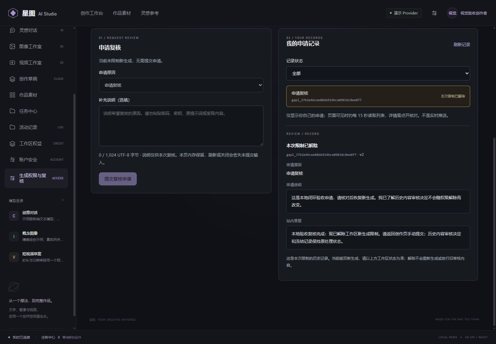

# 星图 AI 工作台 · AIGongZuotai

面向个人创作者的 AI 工作台。React + TypeScript 前端，Go 核心后端，按实时 LLM 与异步媒体任务分别组织执行链路。总体设计见 [落地开发方案](docs/deliverables/Go与NewAPI高性能AI工作台开发方案.html)。

**当前版本：v0.20.0，V16-A3.3媒体公平与持久退避本地已验收，保留A3.2/A3.1/A1/A2能力。** V14-C1工作区新生成限制与复核本地闭环保留。 图片/视频产物先保存为私有候选，整组通过且事务提交成功才开放预览、下载和结算；新参考图先检查原件再登记。V14-B1文本审核与V14-A运营核实继续保留。真实审核商按用户安排后续选型，C1提供工作区新生成限制、复核申请和答复，C2账户/内容申诉及C3自动额度风控另行推进，完整V14仍进行中。V00—V06、V08—V10和V12共11/23整批已验收，见[TODO](TODO.md)。V11真实邮件与V07真实供应商另验。当前仍是单控制写者、本地开发版本，尚不能作为公众收费站点上线；demo与fixture不代表真实模型或审核能力。



## 当前能力

| 模块 | 已实现 |
| --- | --- |
| 工作台 | 聊天、图像、视频、作品素材、任务中心；模型/完整规格/数量选择、UTF-8字节限制、灵感模板、桌面和移动布局 |
| 模型目录 | 启动加载有限JSON配置、私有映射、逐模型能力版本与ETag；启停/版本仅约束新请求，历史任务保留原快照 |
| 账户与项目 | PostgreSQL 注册/登录/退出、HttpOnly cookie、项目/工作区权限；邮箱验证、密码找回/修改、会话撤销及账户安全记录 |
| 安全邮件 | 独立TLS SMTP、AES-GCM加密持久队列、有限重试；确认不明停止重投，默认关闭，真实渠道待配置 |
| 文本审核 | 默认关闭；实际输入锁外审核、冻结策略、全文通过且事务成功才展示；隔离正文不进历史/上下文，正常新提问略过受限整轮；本地规则与HTTP模拟器已验，真实渠道待选 |
| 媒体审核 | 独立策略、真实原件字节、私有候选与整组交付；租约/取消/恢复隔离、访问门禁和已执行额度待核实，默认关闭，真实渠道待选 |
| 运营核实 | 独立工作区observer/operator/finance角色、异常工单、安全元信息、真实预演与密码确认、原handle核对/REVIEW结算释放、收据和审计；默认关闭，角色仅停机CLI管理 |
| 生成权限与复核 | 显式moderator、限制未来生成、原幂等优先、用户复核、真实预演及当前密码确认、公开答复和已提交回执；解除不放行隔离内容 |
| 创作权益 | 六位整数精度、生成前报价与确认、工作区钱包/流水、原子冻结/结算/释放；未知待核实、停机预演及追加冲正，默认关闭，无真实支付 |
| 聊天 | 持久多会话、不可变分支、真正的多条messages、上下文预算/整轮裁剪、SSE/停止/显式继续；未启用审核时崩溃保留检查点，开启时未审候选仅内存且恢复保持隔离；旧单轮历史保留 |
| 媒体任务 | 集中查询、版本与恢复；普通demo为SVG/视频海报；开启媒体fixture后为固定PNG/一秒MP4，明确非AI生成；live 文生图、图片编辑与文生视频通过服务端适配器接入 |
| 参考素材 | PNG/JPEG/WebP真实校验、私有原件与512px缩略图、项目内复用、有序1—4张引用、上传幂等与原文件重试 |
| 提交正确性 | 创建运行/任务使用幂等键；同键异参 409；网络受理不明时保留原键显式重试 |
| 创作草稿 | PG项目私有云端草稿、不可变版本、并发冲突、原键重试、恢复旧稿为新版；memory保留本地草稿；尚不是可执行画布 |
| 编辑保护 | 未保存切项目/退出提示，同账号同项目重登录恢复本页内存编辑；刷新/关闭前仍须保存或导出 |
| 活动记录 | 项目/工作区范围、游标分页、业务变更与审计同事务、幂等不重复；不含提示词/正文/凭据，非账单 |
| 网关边界 | LLM 实时流、图片/视频异步协议、精确请求体幂等、未知受理状态；密钥仅在服务端 |
| 资产库 | 独立目录与游标搜索、标签、元数据历史、CAS幂等、回收站/恢复；来源区分上传、生成与demo |
| 私有存储 | 本地产物或S3兼容私有对象、512px图片缩略图、鉴权Range下载、copy+verify迁移、默认只读的离线孤立文件检查 |
| 持久通知 | 业务/审计与Outbox同事务、幂等消费、范围游标和有限窗口回放；前端有界补读，不覆盖未保存/未知操作 |
| 任务租约 | PG到期领取、周期续约、owner/epoch/generation/业务版本隔离；无handle的未知提交不自动重发 |
| 媒体执行隔离 | submit/query/delivery/review四通道固定预算及独立PG连接；019首次审核证据、共享审核许可；取消实际退出才释放预算 |
| 恢复 | 无交付清单的已知任务只查询原handle；有清单只补原集合，有完整收据不重下；已完成资产可独立于供应商启用状态下载，编辑保持原引用及正文 |
| 聊天执行调度 | 单写者workspace轮转；全局/工作区/冻结上游模型执行预算、等待队列容量、取消释放和固定指标；媒体独立首次审核已在A3.2验收，持久token日志仍待办 |
| 资源准入 | 工作区/模型未终态任务与SSE上限；未知任务继续占用，已有幂等重放优先 |
| 运行可观测 | 存活/就绪探针、独立运维令牌指标、请求编号；用户工作区容量与限流冷却反馈 |
| 工程治理 | Wiki、逐次变更台账、README/TODO同步检查、10模块/23批次验收、PR检查及OpenAPI |

## 开发规则

所有贡献者必须先阅读 [AGENTS.md](AGENTS.md)。**任何代码、配置、依赖、测试、文档或规则变更，都必须登记台账，同步更新 README 与相关 Wiki。**

后续工作按 10 个横向模块、23 个纵向批次推进，以 [TODO](TODO.md) 查看当前状态。每批有范围、依赖、验收条件和证据，完成一批更新一批；[任务维护说明](docs/planning/README.md)解释如何更新唯一任务源并生成勾选状态。已验收批次数量不代表整体工期百分比。

- [统一文档入口](docs/README.md) · [完整 TODO](docs/planning/TODO.md) · [持续推进记录](docs/planning/progress.md)
- [Wiki 入口](docs/wiki/README.md)
- [变更台账](docs/changes/README.md)
- [台账模板](docs/changes/TEMPLATE.md)
- [阶段架构决策](docs/wiki/decisions/0001-phase-one.md)
- [当前 OpenAPI 契约](docs/api/openapi.yaml)

## 本地启动

要求 Node.js 22.12+、npm、Go（版本以 `go.mod` 为准）。在仓库根目录执行：

```sh
npm run setup
npm run dev
```

工作台：<http://127.0.0.1:5173>。Go API：<http://127.0.0.1:8080>。`Ctrl+C` 关闭本命令启动的进程。默认配置无需密钥；可将 `.env.example` 复制为 `.env` 调整服务端配置。不得把密钥写入 `VITE_*` 环境变量。

无数据库时默认内存演示模式，服务重启清空运行记录。Windows 可启用仓库独立的便携 PostgreSQL：

```sh
npm run db:setup
npm run dev:db
```

数据库工具和数据位于 LocalAppData 下按工作区路径哈希区分的英文目录，凭据保存在忽略的 `.runtime/postgres.env`，不打印密码；数据库不会随工作台关闭，另用 `npm run db:stop`。已有 PostgreSQL / Linux / macOS 配置 `DATABASE_URL` 后运行 `dev:db`。详见[本地数据库说明](docs/wiki/local-database.md)。

`npm run dev` 读取根 `.env`；`dev:db` 额外补充本地数据库配置并强制启用账户。真实 LLM 要求 `PROVIDER_MODE=live`、`NEWAPI_BASE_URL`（API 根，含 `/v1`）和 `NEWAPI_API_KEY`；不使用目录文件时另需 `NEWAPI_CHAT_MODEL`，使用目录时由对应私有 `upstream_model` 提供映射。异步媒体按[网关说明](docs/wiki/media-gateway.md)单独配置模型、服务根地址、服务端密钥与素材域名白名单。前端按逐模型 capabilities 开放功能；上游无取消接口时不显示虚假的取消成功。

参考素材默认保存至 `REFERENCE_DIR=.runtime/references`，须与静态目录及 `ASSET_DIR` 分离。持久模式应同时备份数据库和两个私有目录；升级016后旧程序不能直接写新库，启用邮件还须联备队列密钥。单图8MiB/16M像素，工作区100条/128MiB，整个参考目录2GiB/4096文件；回收站不释放配额；受引用文件保留，孤立文件只能通过停机维护计划回收。live编辑需要在模型配置中明确启用 `image_edit_supported` 和 `max_reference_images`。详见[参考素材Wiki](docs/wiki/references.md)。

资产库使用独立PG表与项目权限，历史版本只覆盖名称/标签/回收状态，不代表图片或视频内容版本。`ASSET_STORAGE_BACKEND=s3`启用私有对象存储，配置详见[对象存储Wiki](docs/wiki/object-storage.md)。当前参考图、编辑请求文件及S3收据仍依赖私有本地目录，尚不支持无状态多实例。

每个私有目录使用操作系统排他锁，PG数据库UUID与目录角色绑定到owner文件。绑定后的目录禁止用memory模式打开，不能删除owner文件绕过失败；测试/内存演示请使用独立的`REFERENCE_DIR`与`ASSET_DIR`。离线维护默认只生成计划，详见[维护与恢复](docs/wiki/storage-maintenance.md)；升级与回滚必须匹配数据库和私有文件备份。

`TASK_LEASE_SECONDS`默认30、范围5—300；PG worker使用数据库时钟领取/续约。业务控制面和目录锁保持，不能据此同时启动多个工作台服务。持久事件窗口过期时补读资源状态，LLM逐token流仍不是持久日志。详见[事件说明](docs/wiki/events.md)及[任务租约](docs/wiki/scheduler.md)。

模型目录可用 `MODEL_CATALOG_FILE=config/models.example.json` 启用[示例配置](config/models.example.json)，不设置时兼容原三个默认模型；live模式需将私有 `upstream_model` 替换为网关实际模型。目录只在启动时读取，修改后重启；尺寸、比例、分辨率和时长按整组预设提交。配置限制、版本错误、ETag与历史任务规则见[模型 Wiki](docs/wiki/models.md)。当前本地预览启用示例目录，仍使用 demo Provider，不发真实收费请求。

多轮对话由服务端根据选中分支构造上下文，浏览器不上传任意历史。模型配置`context_window_tokens`和`max_output_tokens`；私有`chat_output_limit_field`明确选择上游输出限制字段。估算不等于真实token账单，继续生成是新的模型请求。会话选择ID可在刷新后恢复，未发送输入和受理不明请求仅当前页面内存保护。详见[会话Wiki](docs/wiki/conversation.md)和[Provider契约](docs/wiki/chat-provider.md)。

账户安全入口位于侧栏和账户菜单。未配置邮件时，验证与找回显示明确不可用；改密和撤销当前/全部会话会要求重新登录。邮件启用前须设置服务端`AUTH_MAIL_*`、可信回站地址及独立32字节加密密钥，密钥需随数据库安全备份，配置见[账户安全](docs/wiki/account-security.md)和[邮件投递](docs/wiki/mail-delivery.md)。本地自动测试仅使用独立TLS模拟器，不会继承真实邮件配置外发。

构建后可在根目录直接运行 `.runtime/server.exe`（Windows）或 `./.runtime/server`（Linux/macOS），由 Go 同源提供 `apps/workbench/dist` 和 API，访问 <http://127.0.0.1:8080>。这个入口仍是本地开发模式，不能直接部署成公众收费站点。

V12权益配置已接入，默认关闭；`BILLING_MODE=credits`须数据库、账户模式和`BILLING_PRICE_FILE`。本地示例价格只用于demo，新钱包不自动赠送额度。报价确认后冻结最大值，可信用量/交付结果结算，未知保留待核实；离线预演/核账/一次全额冲正见[配置与操作](docs/wiki/billing-operations.md)。真实支付仍属V13。

运营配置`OPERATIONS_ENABLED=true`要求PG和`AUTH_MODE=required`；注册及工作区owner不自动获权。先停服务，通过`go run ./cmd/operations`显式授予目标用户/工作区角色，默认只预演，执行须精确摘要和稳定操作键，详见[角色管理](docs/wiki/operations-access.md)。授权后侧栏出现[运营核实](docs/wiki/operations-workbench.md)；此入口不提供在线赠额、支付退款、内容审核或封禁。016升级继续联备数据库、私有目录和已启用邮件时的独立密钥。

文本审核默认 `MODERATION_MODE=disabled`；本地闭环使用PG账户模式、demo Provider、`MODERATION_MODE=rules` 与 `MODERATION_POLICY_FILE=config/moderation.example.json`。真实接入使用 `http` 及服务端适配配置，协议见[审核引擎](docs/wiki/moderation.md)；它不是New API通用接口，尚无真实供应商验收。启用后完整回复通过检查才展示，未审候选不保存；输入拒绝不冻结，已执行但隔离的输出保留待核实。只开文本审核时拒绝新图片/视频生成；同时开启下述媒体审核后才开放。历史内容不批量追审，但新编辑请求须重新检查实际引用原件。

媒体审核默认 `MEDIA_MODERATION_MODE=disabled`。本地需同时启用文本规则，并设置 `MEDIA_MODERATION_MODE=fixtures`、`MEDIA_MODERATION_POLICY_FILE=config/media-moderation.example.json`；必须使用PG账户模式。fixture只识别仓库登记的完整PNG/MP4字节；未知文件不自动批准。真实服务使用私有流式multipart `media-v1` 适配协议，见[引擎](docs/wiki/media-moderation.md)、[执行链](docs/wiki/media-moderation-execution.md)、[工作台](docs/wiki/media-moderation-workbench.md)和[ADR0012](docs/wiki/decisions/0012-media-review-gate.md)。已登记候选纳入所有终态的存储可达性；没有人工重审/自动放行入口。

v0.14历史验证：270项前端/26文件、8项治理、Go vet/测试/构建、真实PG全量192.482秒和六套隔离冒烟通过；新增PARTIAL定向PG1.675秒。已完成016联备升级、桌面/390手机验收、私有视频实际播放和空参考报价白屏修复。详见[058联合台账](docs/changes/2026-11-14-058-media-review-integration.md)与[联合证据](docs/wiki/assets/media-moderation-validation-v0.14-2026-11-14.json)。主JS505.19kB触发分包警告，后续按路由拆包；[本机demo回归](docs/wiki/performance.md)不代表审核吞吐或生产容量。

## 工程命令

媒体通过`MEDIA_SUBMIT_WORKERS`、`MEDIA_QUERY_WORKERS`、`MEDIA_DELIVERY_WORKERS`配置三通道，v0.19通过`MEDIA_REVIEW_WORKERS`配置独立审核通道。默认各2；提交/查询显式十进制1—32，交付1—16，审核1—2，重启生效。审核输出与参考输入共用原两个引擎许可；新增worker不扩大总审核并发。原生异步适配器先持久保存加密清单，再下载并交接首次审核；普通SVG demo没有真实下载。PG接入原生异步媒体须先设置独立32字节标准base64的`MEDIA_DELIVERY_KEY`，不得复用邮件或网关密钥，必须与PG、私有目录及对应对象版本联备。已有交付即使终态仍需原密钥，不能关闭provider绕过。边界见[媒体交付Wiki](docs/wiki/media-delivery.md)及[A3.2契约](docs/planning/v16a32-contract.md)，此设置不代表供应商QPS或多实例共享配额。v0.20新增MEDIA_WORKSPACE_CONCURRENCY（默认1）和MEDIA_CHANNEL_CONCURRENCY（默认2），每lane按工作区/冻结渠道约束，显式1—32；本地公平、持久退避及积压预选已验收，不能推定生产吞吐。

| 命令 | 用途 |
| --- | --- |
| `npm run setup` | 按前端锁文件安装依赖 |
| `npm run dev` | 启动 Go API 与 Vite，包含服务就绪检查 |
| `npm run dev:db` | 启动 PostgreSQL 账户模式工作台 |
| `npm run db:setup` / `db:start` / `db:stop` / `db:status` | Windows 便携 PostgreSQL 初始化与启停 |
| `npm run build` | 构建前端与 Go 二进制到 `.runtime/` |
| `npm test` | 任务治理、Go 与前端关键逻辑测试 |
| `npm run test:db` | 使用独立 TEST_DATABASE_URL 运行持久化、身份与恢复测试 |
| `npm run check` | TODO一致性、Go vet、测试、生产构建、文档结构与链接检查 |
| `npm run check:changes` | 检查当前变更是否同步 README、Wiki、台账、任务源及TODO |
| `npm run todo:sync` | 从任务源生成 TODO，完成状态必须具备验收证据 |
| `npm run check:todo` / `test:todo` | 检查批次依赖、完成门槛、生成一致性及治理规则测试 |
| `npm run smoke` | 启动独立临时 demo 服务验证完整链路，结束后关闭；先运行 build，不接触现有网关 |
| `npm run smoke:runtime` | 独立小限额实例验证探针、指标权限、准入/幂等与SSE名额释放 |
| `npm run smoke:catalog` | 独立目录实例验证模型映射、版本/ETag、精确规格、重启启停与幂等 |
| `npm run smoke:references` | 独立参考素材实例验证上传/幂等/权限、编辑链路、审计及指标；不发真实请求 |
| `npm run smoke:library` | 独立资产库实例验证检索、权限、版本、回收恢复、旧URL拒绝及审计 |
| `npm run smoke:conversations` | 独立Go+HTTP网关fixture验证真实多轮messages、编辑分支、继续、预算裁剪、原键与权限；不发真实收费请求 |
| `go run ./cmd/storage` | 离线S3迁移计划；显式apply后复制与完整校验，本地副本保留 |
| `go run ./cmd/maintenance` | 停机检查孤立文件；apply必须携带当前计划摘要 |
| `go run ./cmd/ledger` | 停机核账、赠额、一次全额权益冲正及待核实处置；默认只预演 |
| `go run ./cmd/operations` | 停机inspect/grant/revoke运营角色；默认预演，001—015格式栅栏，稳定操作键与精确摘要 |
| `npm run perf:local` | 隔离 demo 性能基线，输出分位数及机器环境；不代表生产容量 |

## 目录

```text
apps/workbench/          React 工作台
cmd/server/             本地组合部署 Go 入口
cmd/storage/            私有产物到S3的离线迁移
cmd/maintenance/        绑定数据库身份的离线孤立文件维护
cmd/ledger/             权益账本离线预演、核账与处置
cmd/operations/         工作区运营角色停机预演与授予/撤销
internal/               Go 领域、执行、适配与 HTTP 服务
scripts/                启动、检查与开发工具
docs/wiki/              架构、开发、模块说明、路线及 ADR
docs/changes/           逐次变更台账
docs/api/               当前已实现 API 的 OpenAPI 契约
docs/planning/          模块/批次任务源与维护规则，生成根 TODO.md
docs/deliverables/      原始方案与离线交互蓝图
docs/planning/          完整TODO、任务源与持续推进记录
docs/testing/           测试样本来源和用途说明
db/migrations/         内嵌数据库SQL脚本
```

## 最近变更

- [086 · 分页恢复与先行generation栅栏（实施/待验）](docs/changes/2026-11-15-086-paged-recovery.md)
- [087 · 完整启动分页恢复独立验收（实施/待验）](docs/changes/2026-11-15-087-recovery-validation.md)
- [088 · 完整启动恢复故障验收（实施/待验）](docs/changes/2026-11-15-088-recovery-faults.md)
- [085 · 恢复私有阶段有界批读](docs/changes/2026-11-15-085-recovery-private-phases.md) · [实现与限制](docs/wiki/recovery-private-phases.md)
- [084 · 分页恢复与有界缓存设计启动](docs/changes/2026-11-15-084-recovery-plan.md) · [A4契约](docs/planning/v16a4-contract.md)
- [083 · 媒体公平调度与联合验收](docs/changes/2026-11-15-083-media-scheduler-integration.md) · [A3.3契约](docs/planning/v16a33-contract.md)

- [079 · V16-A3.2首次审核分派与联合验收](docs/changes/2026-11-14-079-media-review-dispatch-integration.md)
- [075 · V16-A3.1持久私有交付与联合验收](docs/changes/2026-11-14-075-media-delivery-integration.md)


- [071 · V16-A2媒体执行隔离与联合验收](docs/changes/2026-11-14-071-media-lane-integration.md)

- [065 · 聊天公平调度核心](docs/changes/2026-11-14-065-execution-scheduler.md)
- [066 · 聊天执行独立验收](docs/changes/2026-11-14-066-execution-validation.md)
- [067 · V16-A1配置、观测与集成](docs/changes/2026-11-14-067-execution-integration.md)

- [063 · 文档归档与TODO双入口治理](docs/changes/2026-11-14-063-document-layout.md)
- [064 · SQL统一归档与嵌入](docs/changes/2026-11-14-064-sql-layout.md)

- [059：生成权限与复核核心](docs/changes/2026-11-14-059-generation-controls.md)
- [060：新生成准入与角色](docs/changes/2026-11-14-060-generation-admission.md)
- [061：复核工作台与恢复保护](docs/changes/2026-11-14-061-generation-controls-workbench.md)
- [062：V14-C1联合验收](docs/changes/2026-11-14-062-generation-controls-integration.md)
- [055：媒体策略与私有字节](docs/changes/2026-11-14-055-media-moderation-engine.md)
- [056：媒体执行与交付事务](docs/changes/2026-11-14-056-media-moderation-execution.md)
- [057：媒体审核工作台](docs/changes/2026-11-14-057-media-moderation-workbench.md)
- [058：V14-B2联合验收](docs/changes/2026-11-14-058-media-review-integration.md)

- [051 · 文本审核引擎与策略](docs/changes/2026-11-14-051-text-moderation-engine.md)
- [052 · 文本准入与全文交付隔离](docs/changes/2026-11-14-052-moderation-execution.md)
- [053 · 文本审核工作台](docs/changes/2026-11-14-053-moderation-workbench.md)

- [054 · V14-B1文本审核联合验收](docs/changes/2026-11-14-054-text-review-integration.md)

- [047 · 运营权限与角色治理](docs/changes/2026-11-14-047-operations-access.md)
- [048 · 异常工单与预演处置](docs/changes/2026-11-14-048-operations-cases.md)
- [049 · 运营异常核实工作台](docs/changes/2026-11-14-049-operations-workbench.md)

- [050 · V14-A运营异常核实联合验收](docs/changes/2026-11-14-050-operations-integration.md)

- [043 · 权益账本核心](docs/changes/2026-11-13-043-credit-ledger.md)
- [044 · LLM结构化用量](docs/changes/2026-11-13-044-provider-usage.md)
- [045 · 工作区权益与报价确认](docs/changes/2026-11-13-045-billing-workbench.md)
- [046 · V12权益账本联合验收](docs/changes/2026-11-13-046-billing-integration.md)

- [039 · 账户安全与自助恢复](docs/changes/2026-11-13-039-account-security.md)
- [040 · 加密安全邮件与SMTP](docs/changes/2026-11-13-040-security-mail.md)
- [041 · 账户安全工作台](docs/changes/2026-11-13-041-account-security-workbench.md)
- [042 · V11账户安全本地联合验收](docs/changes/2026-11-13-042-account-security-integration.md)

- [035 · 持久会话与不可变消息树](docs/changes/2026-11-13-035-conversation-core.md)
- [036 · 多消息Provider与上下文预算](docs/changes/2026-11-13-036-chat-provider.md)
- [037 · 多轮对话工作台](docs/changes/2026-11-13-037-conversations-workbench.md)
- [038 · V10联合验收](docs/changes/2026-11-13-038-conversation-integration.md)

- [031 · 持久事件与断点回放](docs/changes/2026-11-13-031-durable-events.md)
- [032 · 任务租约与隔离](docs/changes/2026-11-13-032-task-leases.md)
- [033 · 事件补齐工作台](docs/changes/2026-11-13-033-durable-events-client.md)
- [034 · V09联合验收](docs/changes/2026-11-13-034-durable-execution-integration.md)

- [026 · 独立资产目录与元数据版本](docs/changes/2026-11-13-026-asset-library.md)
- [027 · 私有对象存储与迁移](docs/changes/2026-11-13-027-object-storage.md)
- [028 · 资产库工作台](docs/changes/2026-11-13-028-library-workbench.md)
- [029 · 离线维护与目录归属](docs/changes/2026-11-13-029-storage-maintenance.md)
- [030 · V08联合验收](docs/changes/2026-11-13-030-asset-library-integration.md)

- [022 · 私有参考素材与核心受理](docs/changes/2026-11-13-022-reference-assets.md)
- [023 · 不可变图片编辑请求](docs/changes/2026-11-13-023-media-edit-provider.md)
- [024 · 参考图与图片编辑工作台](docs/changes/2026-11-13-024-reference-workbench.md)
- [025 · V07本地联合验收](docs/changes/2026-11-13-025-reference-integration.md)

- [018 · 版本化目录与执行快照](docs/changes/2026-11-13-018-model-catalog.md)
- [019 · 模型映射与精确上游参数](docs/changes/2026-11-13-019-model-provider.md)
- [020 · 模型与规格工作台](docs/changes/2026-11-13-020-model-workbench.md)
- [021 · V06联合验收](docs/changes/2026-11-13-021-model-integration.md)

- [014 · 工作区与模型准入](docs/changes/2026-11-13-014-resource-admission.md)
- [015 · 健康与运行指标](docs/changes/2026-11-13-015-observability.md)
- [016 · 容量与请求反馈](docs/changes/2026-11-13-016-runtime-workbench.md)
- [017 · V05联合验收](docs/changes/2026-11-13-017-runtime-integration.md)
- [009 · 模块、批次与 TODO 治理](docs/changes/2026-11-13-009-batch-tracking.md)
- [010 · 云端草稿与不可变版本](docs/changes/2026-11-13-010-project-drafts.md)
- [011 · 云端草稿与活动工作台](docs/changes/2026-11-13-011-drafts-activity-workbench.md)
- [012 · 事务审计与活动记录](docs/changes/2026-11-13-012-transactional-audit.md)
- [013 · v0.3 批次联合验收](docs/changes/2026-11-13-013-batch-integration.md)
- [004 · 持久化与账户](docs/changes/2026-11-13-004-persistence-auth.md)
- [005 · 实际异步媒体协议](docs/changes/2026-11-13-005-media-gateway.md)
- [006 · 账户与项目工作台](docs/changes/2026-11-13-006-accounts-projects.md)
- [007 · 数据库开发环境与集成](docs/changes/2026-11-13-007-integration-database.md)
- [008 · 本地性能基线](docs/changes/2026-11-13-008-performance-baseline.md)
- [001 · 工程规则、Wiki 与交付治理](docs/changes/2026-11-13-001-foundation.md)
- [002 · Go 核心执行链路](docs/changes/2026-11-13-002-go-core.md)
- [003 · React 工作台](docs/changes/2026-11-13-003-workbench.md)

## 验证状态

2026-11-14，V14-A的`npm run check`和真实PG全量`npm run test:db`通过（studio169.657秒）；217项前端/23文件、8项治理、Go vet、严格TS、生产构建、六套隔离冒烟通过。OpenAPI为61路径/73操作/82 schemas/340引用。PG验证授权/撤权、密码重核、预演过期/CAS、原任务只查询、旧租约拒写、审计回滚及COMMIT确认丢失后重启只读取唯一收据。详见[050台账](docs/changes/2026-11-14-050-operations-integration.md)与[验证汇总](docs/wiki/assets/operations-validation-v0.12-2026-11-14.json)。

真实Go+PG/demo浏览器完成开单→修改证据使旧预演失效→错误密码拒绝→正确密码确认→释放0.045056演示创作点→收据与5条审计补读。普通账户无运营入口，observer范围只读，390×844及1440×1000无横向溢出；近期console warning/error为0。见[浏览器证据](docs/wiki/assets/operations-browser-v0.12-2026-11-14.json)。012→014停写联备后保留旧资产/修订、草稿、会话、运行和账本；没有自动运营授权，[升级比对](docs/wiki/assets/operations-upgrade-v0.12-2026-11-14.json)可查。

本地memory/demo基线bootstrap P95 21.97ms、2350.71请求/秒；任务创建+取消P95 12.39ms，demo首delta P95 56.95ms。[原始报告](docs/wiki/assets/performance-local-v0.12-2026-11-14.json)仅用于同机回归，关闭PG/鉴权/权益/邮件/运营，不代表运营事务或生产容量。本轮未调用真实收费AI、邮件或支付。

### v0.11 历史验收

2026-11-14，V12最终`npm run check`、真实PG全量`npm run test:db`通过（studio148.283秒）；202项前端/22文件、8项治理、Go vet、严格TS和生产构建通过。六套隔离冒烟及本地性能回归通过；OpenAPI为54路径/65操作/67 schemas/311引用。PG覆盖并发超扣、原键、回滚、提交确认丢失、可信usage、实际进程Kill恢复及离线对账。详见[046联合验收](docs/changes/2026-11-13-046-billing-integration.md)。

浏览器在PG/demo下完成聊天、图片、视频海报的报价→确认→冻结→结算；100演示点结算后可用97.799616、累计消费2.200384，冻结/待核实为0。验证输入变化撤销旧报价、流水/冻结单筛选、390×844界面无横向溢出，console warning/error为0。证据见[浏览器记录](docs/wiki/assets/billing-browser-v0.11-2026-11-14.json)及[012升级比对](docs/wiki/assets/billing-upgrade-v0.11-2026-11-13.json)。升级前完成数据库与私有目录联备；旧资产、草稿和会话保留，未自动赠额或追扣旧任务。

本地memory/demo基线：bootstrap／32并发P95 26ms、2077.83请求/秒，任务创建+取消P95 14.7ms，demo首delta P95 56.96ms；关闭数据库、鉴权、邮件与权益，不代表PG账本或生产容量。见[性能报告](docs/wiki/assets/performance-local-v0.11-2026-11-14.json)。本轮未调用真实收费AI、邮件或支付。

### v0.10 历史验收

2026-11-13：`npm run check`、173项前端测试、8项治理、Go vet/严格TS/构建、六套隔离冒烟及OpenAPI 50路径/61操作/293引用通过。根真实PostgreSQL全量studio115.317秒，覆盖既有业务、账户令牌/会话/改密竞争/事务回滚、TLS SMTP完整HTTP链和实际进程Kill。SMTP确认不明及崩溃恢复不会重复投递。

浏览器验收账户安全页、测试会话真实撤销与401、安全事件、验证fragment清除和显式确认、失效链接不重试、匿名找回未配邮件禁用；390×844安全/恢复页面无横向溢出，近期console warning/error为0。升级011前停写联备；对照旧dump确认草稿v5、资产修订v10、8个资产和12个会话节点保留，旧Cookie继续有效。详见[042联合验收](docs/changes/2026-11-13-042-account-security-integration.md)、[浏览器证据](docs/wiki/assets/account-security-browser-v0.10-2026-11-13.json)和[升级比对](docs/wiki/assets/account-security-upgrade-v0.10-2026-11-13.json)。

本地memory/demo基线1000次bootstrap／32并发P95 22.08ms、约2262请求/秒；不覆盖PG账户、bcrypt、TLS或真实网关，不能作为生产容量成绩。见[性能报告](docs/wiki/assets/performance-local-v0.10-2026-11-13.json)。未外发真实邮件、未提交真实付费生成；浏览器未改主QA密码，密码写操作通过独立Go HTTP/PG测试覆盖。

### 后续放行

当前仍是单控制写者；逐token持久日志、跨实例运行和公开收费闸门尚未完成。本机Go race所需CGO/C编译器不可用，Linux CI已配置但未远程执行。S3真实兼容服务验收保留V08证据，本轮未重复未改变的专项。

当前自动推进**V16-A4分页恢复与有界缓存，随后实现B持久流与隔离**（已满足V05/V09依赖）；V14-C2账户及内容申诉证据与处置、C3额度与自动风控继续保留完整范围；真实文本与多模态审核渠道继续单列待验，依赖的V11真实邮件尚未放行，V14不能提前标整批完成。V13可先准备订单/支付适配与回调fixture，真实验收需V11及商户配置。V07/V15保留真实模型联调条件；V16的已验收依赖已齐备，可独立推进分布式流与公平调度，V17另做生产容量验收。见[TODO](TODO.md)与[路线](docs/wiki/roadmap.md)，批次数量不代表整体工期百分比。

## v0.15 / V14-C1 本地验收

本地完整链已完成：显式moderator限制新生成→用户申请复核→真实预演/当前密码确认→公开答复/解除→用户手动新生成。原键、旧任务、历史内容和账务按原规则保留；解除不会放行隔离内容。

297项前端/28文件、8项治理、Go vet/构建、PG全量282.020s、六套隔离冒烟与71路径/83操作/411引用通过。016→017联备升级保留旧数据；桌面/390手机完整验收，独立运营和普通账户权限分离。首页JS494.93kB、gzip156.88kB，用户/运营页面按需加载，移除500kB警告；不等于生产容量或LCP/INP验收。

[062联合台账](docs/changes/2026-11-14-062-generation-controls-integration.md) · [验证证据](docs/wiki/assets/generation-controls-validation-v0.15-2026-11-14.json) · [浏览器](docs/wiki/assets/generation-controls-browser-v0.15-2026-11-14.json) · [017升级](docs/wiki/assets/generation-controls-upgrade-v0.15-2026-11-14.json) · [C1契约](docs/planning/v14c1-contract.md)。两次PG失败的夹具原因、修复及最终复跑均保留在台账；没有放宽生产门禁。C2/C3、真实渠道和V16/V17继续按TODO推进。

## v0.16 / V16-A1 本地验收

聊天按工作区轮转，冻结上游模型别名共享执行预算；总队列/工作区队列有界。原幂等优先、事务提交后入队，取消运行需等实际调用退出才释放预算。新增五项CHAT配置与11项受保护固定指标；媒体通道、持久token日志和跨实例配额仍待办。

301项前端/29文件、10项治理、Go vet/构建、PG全量238.022s、六套隔离smoke及OpenAPI引用通过。主JS495.68kB/gzip157.13kB；新配置同workspace同时执行2、客户端4并发，因此首delta包含排队，不能与旧四活跃流直接比较或宣称生产提速。详细结果见[067](docs/changes/2026-11-14-067-execution-integration.md)、[验证汇总](docs/wiki/assets/execution-validation-v0.16-2026-11-14.json)、[调度Wiki](docs/wiki/execution-scheduler.md)。

本轮文档归docs、17SQL归db且字节不变。当前环境旧LocalAppData开发PG不可用，验收另用独立测试实例；原配置、私有文件和备份保留，未声称恢复原开发库。本批只改排队反馈协议，无布局调整；未重复旧浏览器视觉验收。下一批自动推进A2，V16仍进行中，全产品未完成。

## v0.17 / V16-A2 本地验收

媒体提交与查询交付在worker、PG辅助连接及HTTP池上隔离；先预留预算再领取，原handle、未知提交、租约、B2隔离与权益规则保持。新增严格MEDIA配置和六个固定运维指标；旧内部TaskWorkers=1变为双通道最小1+1。

全量Go/PG、301项前端、10项治理、生产构建和六smoke通过；最终PG318.880s。首轮两个账户用例超时及不改断言的复验均记入[071台账](docs/changes/2026-11-14-071-media-lane-integration.md)，完整[验证汇总](docs/wiki/assets/media-lanes-validation-v0.17-2026-11-14.json)与[HTTP通道说明](docs/wiki/media-transport-lanes.md)可核对。

query仍包括下载导入/审核，混合到期索引尚未证明扫描成本隔离；本机性能是memory/demo口径，创建加取消不等于媒体吞吐。下一步自动推进A3.1持久私有交付，A3.2首次审核分派及A3.3渠道公平退避已分入TODO，完整V16和公众收费上线仍未完成。

## v0.18 / V16-A3.1 本地验收

原生异步媒体现在分为submit、QueryStatus及delivery三条执行通道。查询不再下载；018事务先冻结加密清单和计划ID，再逐件导入并保存完整收据。已提交清单在重启后不换批、不重POST，已完成收据缺失或篡改则待核实；整组审核、资产、权益及Outbox仍以事务确认后公开。

完整check、301前端/29文件、10治理、Go vet/构建、六smoke、最终全PG301.345s通过；包含真实本机S3、017→018升级、COMMIT故障及两种pg_dump/pg_restore。首轮旧测试缺密钥与S3两步假设的失败及修正保留在[075台账](docs/changes/2026-11-14-075-media-delivery-integration.md)，可核对[验证汇总](docs/wiki/assets/media-delivery-validation-v0.18-2026-11-14.json)、[交付Wiki](docs/wiki/media-delivery.md)及[性能口径](docs/wiki/performance.md)。

S3恢复用例保留原远端对象，没有恢复S3服务，本次没有VersionId；不是云灾备。PG与私有目录仍单控制写者，首次审核仍占delivery；A3.2将增加持久首次审核交接，A3.3公平退避、持久token流及完整公众收费产品继续按TODO推进。

## v0.19 / V16-A3.2 本地验收

首次审核现为独立review通道：候选与019 READY同事务，STARTED确认提交后才外发。READY恢复可以首次审核，旧候选和STARTED恢复保持隔离；取消、失租和确认不明不晚放行。输入与输出共用原两个审核许可，完整收据及原件/缩略图在审核前校验。新派发不改变原请求、原handle、价格或幂等。

完整check、301前端/29文件、10治理、Go vet/构建、六smoke及最终全PG368.160s通过。真实本机版本化S3、018→019升级、READY/STARTED提交故障及pg_dump恢复均通过，审核恢复保留4/4真实对象版本。结果及首次失败修正见[079台账](docs/changes/2026-11-14-079-media-review-dispatch-integration.md)、[联合证据](docs/wiki/assets/media-review-dispatch-validation-v0.19-2026-11-15.json)、[审核分派Wiki](docs/wiki/media-review-dispatch.md)。

S3远端服务仍是保留原对象，没有灾备恢复；全站多实例和生产容量未验收。当前许可保守保持到最终保存退出，公平和饥饿控制留待A3.3；下一步按冻结渠道预算、持久冷却/退避与大积压SQL测量推进，持久token流及完整公众产品范围继续保留。

## v0.20 / V16-A3.3 本地验收

媒体四通道现在按工作区轮转，并按冻结渠道限制并发；Retry-After、冷却和GET探测状态持久保存，重启不清退避。输入/输出审核共享原两个许可，有界等待并公平分配；原幂等、未知提交和STARTED审核不因调度重发。

完整check、301前端/29文件、10治理、最终全PG 443.228s、六smoke、实际版本化S3及冷却/候选联备恢复通过。180条真实SQL计划与48次完整预选独立留存；10万活跃+10万历史下完整预选24样本P95 16.302ms（不含claim/HTTP）。20万旧任务迁移11.229秒、59原表保持，但未证明完整App启动容量。证据见[083](docs/changes/2026-11-15-083-media-scheduler-integration.md)、[联合JSON](docs/wiki/assets/media-scheduler-validation-v0.20-2026-11-15.json)及[调度Wiki](docs/wiki/media-scheduler.md)。

仍是单控制写者与单个已配置Async网关。完整活跃任务恢复N+1、持久token日志、跨实例隔离和综合测量继续推进；真实服务及公开收费上线未完成。

[084 · 分页恢复与有界缓存设计启动](docs/changes/2026-11-15-084-recovery-plan.md)：下一阶段按[A4契约](docs/planning/v16a4-contract.md)先解决单次启动分页/Outbox背压，再验PG缓存与完整New容量。085已接入每页128项/16 MiB私有阶段批读，并验证固定5次SELECT与快照/ACK边界；整体恢复协调器和有界缓存仍未完成，A4.1保持待验。
