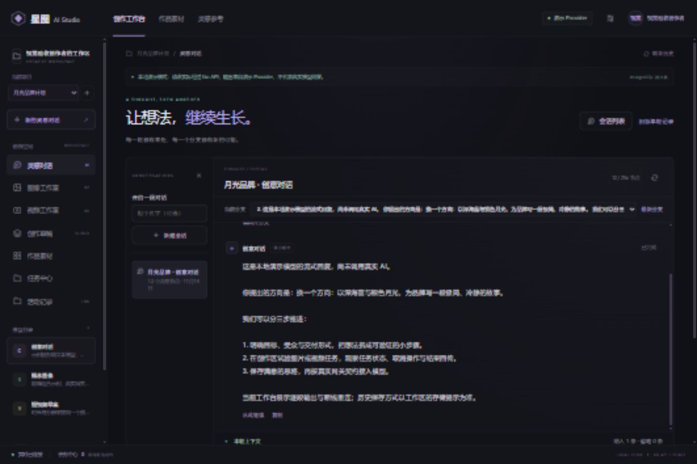
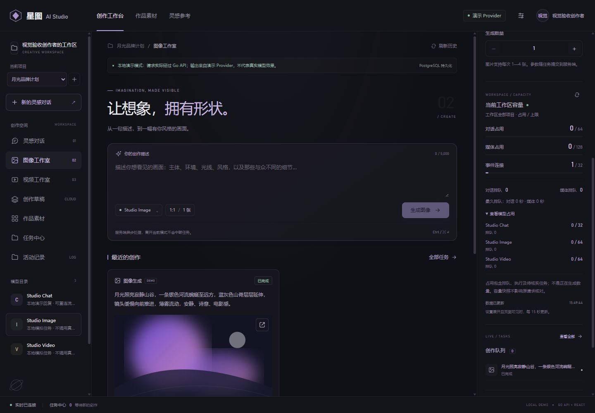

# AI 工作台 Wiki

这里记录仓库当前实现、开发方式和后续路线。总体设计来自[Go 与 New API 高性能开发方案](../../deliverables/Go与NewAPI高性能AI工作台开发方案.html)，方案中的吞吐、可靠性和完整产品能力是目标，不代表当前代码已经实现或通过压测。

## 当前状态

截至2026-11-14，当前为v0.13.0：V14-B1文本审核本地链路已验收，V14-A运营异常核实与V12权益继续保留。真实审核商尚未选型，B2图片/视频审核、C申诉封禁及风控待办，完整V14仍进行中。V11真实邮件按用户安排后续配置。数据库账户模式使用`npm run dev:db`，默认demo，不发真实收费请求；权益与文本审核均默认关闭。

V00—V06、V08—V10和V12共11/23批已验收；状态以[TODO](../../TODO.md)为准。V07本地链路已验收，真实供应商环节与V15仍待条件。V11真实邮件渠道、真实支付、完整审核风控、全站多实例和万级容量/灾备未完成，不能直接作为对外收费版本上线。

## 导航

| 页面 | 内容 |
| --- | --- |
| [架构与实施边界](architecture.md) | 本地链路、数据所有权、规划与当前差异 |
| [开发与交付](development.md) | 环境、运行、验证、文档治理规则 |
| [开发 TODO](../../TODO.md) | 10 个横向模块、23 个纵向批次，验收后逐批勾选 |
| [任务维护](../planning/README.md) | 唯一任务源、生成命令、依赖与完成证据校验 |
| [文本审核引擎](moderation.md) | 冻结策略、demo规则、私有text-v1协议与015 |
| [文本审核执行](moderation-execution.md) | 输入准入、候选隔离、事务放行与恢复 |
| [文本审核工作台](moderation-workbench.md) | 全文审核提示、乱序保护与隔离回复 |
| [ADR0011：全文审核后交付](decisions/0011-text-review-gate.md) | 首字延迟取舍、隐私与恢复边界 |
| [运营权限与角色管理](operations-access.md) | 最小工作区角色、密码确认与停机授权 |
| [运营异常工单](operations-cases.md) | 元数据队列、真实预演、事务处置与恢复 |
| [运营核实工作台](operations-workbench.md) | 独立作用域、证据确认、未知响应保护 |
| [ADR 0010：有作用域的运营处置](decisions/0010-scoped-operations.md) | 角色边界、预演与已提交收据 |
| [权益账本与任务结算](ledger.md) | 双分录、同事务、恢复和核账约束 |
| [权益工作台](billing-workbench.md) | 钱包、流水、报价确认及原请求恢复 |
| [权益配置与离线核账](billing-operations.md) | 价格、固定精度、报价、待核实、冲正及012升级 |
| [聊天用量证据](chat-usage.md) | 完整usage、缺失/非法用量和demo边界 |
| [ADR 0009：权益账本](decisions/0009-credit-ledger.md) | 不可变分录、同事务结算和离线控制面 |
| [账户安全与自助恢复](account-security.md) | 一次性令牌、密码版本、会话撤销、私有安全活动与011迁移 |
| [安全邮件投递](mail-delivery.md) | TLS SMTP、加密队列、未知不重发、配置及真实渠道条件 |
| [ADR 0008：账户恢复与邮件](decisions/0008-account-security-and-mail.md) | 凭据竞争、事务发件箱、敏感请求与升级边界 |
| [多轮对话与分支](conversation.md) | 持久消息树、CAS/幂等、显式继续、预算裁剪与010迁移 |
| [结构化聊天Provider](chat-provider.md) | 真实messages、输出预算字段、估算和配置边界 |
| [ADR 0007：会话与上下文](decisions/0007-conversations-and-context.md) | 不可变分支、原子受理、冻结执行与上下文策略 |
| [模型目录与规格](models.md) | 配置示例、版本/ETag、精确参数预设与历史任务快照 |
| [参考素材与图片编辑](references.md) | 私有上传、幂等、权限、有序引用、配额与文件恢复 |
| [Go 后端](backend.md) | 实际 API、Provider、状态与测试 |
| [工作台前端](frontend.md) | 实际界面、交互、API 对接与限制 |
| [持久化与账户](persistence-auth.md) | PostgreSQL、身份/项目权限、检查点与重启恢复 |
| [云端草稿与版本](drafts.md) | 项目保存、不可变历史、并发冲突、幂等与恢复 |
| [审计与活动](audit.md) | 同事务业务记录、脱敏字段、权限和分页边界 |
| [异步媒体网关](media-gateway.md) | 真实图片/视频契约、未知状态、素材导入与配置 |
| [本地数据库](local-database.md) | Windows 便携 PostgreSQL、跨平台配置、隔离验证 |
| [资源准入](admission.md) | 工作区/模型/SSE限额、持久未知任务占用、幂等重放优先 |
| [运行可观测](observability.md) | 存活/就绪、受保护Prometheus指标、请求编号与隐私边界 |
| [性能基线](performance.md) | 可复现本地测量、指标口径与生产验收差距 |
| [路线与放行门槛](roadmap.md) | 按总体方案拆分的 20—24 周路线 |
| [ADR 0001：第一阶段边界](decisions/0001-phase-one.md) | 单进程与内存开发存储的选择及退出条件 |
| [ADR 0002：持久单写者阶段](decisions/0002-durable-single-writer.md) | 持久恢复与真实网关接入的实施顺序 |
| [ADR 0003：模型目录与快照](decisions/0003-versioned-model-catalog.md) | 版本化能力、启动配置与执行身份冻结 |
| [ADR 0004：私有参考与精确正文](decisions/0004-private-reference-bodies.md) | 磁盘流式正文、引用关系、配额及备份边界 |
| [独立资产库](assets.md) | 项目目录、搜索/标签、CAS幂等、历史与回收权限 |
| [私有对象存储](object-storage.md) | 本地/S3配置、私有代理、分段下载、迁移与真实兼容测试 |
| [停机维护与恢复](storage-maintenance.md) | 目录归属、排他锁、可达性、计划摘要与联备恢复 |
| [ADR 0005：私有资产生命周期](decisions/0005-private-library-lifecycle.md) | 独立元数据、不可变内容和保守回收 |
| [持久事件与回放](events.md) | 同事务Outbox、持久feed、范围游标、背压与窗口重置 |
| [任务租约与恢复](scheduler.md) | 数据库领取/续约、epoch/generation隔离、受理不明保护 |
| [ADR 0006：持久通知与任务租约](decisions/0006-durable-events-and-task-leases.md) | 事务顺序、执行者隔离与单控制写者边界 |
| [台账索引](../changes/README.md) | 每个逻辑变更的范围、验证与回滚 |
| [当前 OpenAPI](../api/openapi.yaml) | 已实现接口的请求、响应及错误契约 |

## v0.13 文本审核本地子批次验收

[B1契约](../planning/v14b1-contract.md)和[ADR0011](decisions/0011-text-review-gate.md)已实施。真实PG全量170.241秒、审核PG五组8.853秒、237项前端/24文件、8项治理、vet/TS/构建、六套隔离冒烟及OpenAPI61路径/73操作/344引用通过。真实PG COMMIT确认回包丢失后App重启只恢复已提交决策，原键不重复生成；本专项不是OS Kill测试。

浏览器验证输入拒绝不建消息、保留草稿；输出限制且冻结0.045056演示点待核实；新问题可正常提交，服务端省略受限整轮，纳入1条/省略2条，通过后结算0.000384点。刷新后摘要与正文门禁保留；1440×1000和390×844无横向溢出，console warning/error为0。014→015前联备，旧数据未变化且未自动批准历史资源。

[输入拒绝](assets/moderation-input-phase13.jpg) · [输出限制](assets/moderation-blocked-phase13.jpg) · [手机说明](assets/mobile-moderation-phase13.jpg) · [手机受限回复](assets/mobile-moderation-blocked-phase13.jpg) · [浏览器记录](assets/moderation-browser-v0.13-2026-11-14.json) · [升级比对](assets/moderation-upgrade-v0.13-2026-11-14.json) · [验证汇总](assets/moderation-validation-v0.13-2026-11-14.json) · [性能基线](assets/performance-local-v0.13-2026-11-14.json) · [054台账](../changes/2026-11-14-054-text-review-integration.md)。

用户选择先完成本地闭环，真实审核商尚未选型；规则不代表语义准确率，HTTP模拟器不代表真实渠道。未审候选仅进程内存，无人工重审/放行。启用审核时拒绝新图片/视频生成，历史任务与素材不追溯；B2媒体与V14-C另行推进，完整V14仍进行中、11/23整批完成。

## v0.12 运营异常核实本地子批次验收（历史）

V14-A三项check通过；V14-B/C仍待办，V11真实邮件依赖仍未放行，所以整批保持进行中、已验收仍11/23。真实PG全量169.657秒、217项前端/23文件、8项治理、vet/TS/构建、六套隔离冒烟及OpenAPI61路径/73操作/340引用通过。覆盖实时scope/撤权、当前密码重核、预演/CAS/回滚、原handle只查询及旧租约失效；真实PG提交确认回包丢失后App重启只读回原收据，不重复释放。该专项不是本批OS Kill测试。

PG/demo浏览器完成异常开单、证据修改、预演、错误密码拒绝、明确提交及收据/审计补读：演示冻结0.045056点释放，未调用真实AI、SMTP或支付。普通用户无入口，运营范围独立于创作项目；390×844与1440×1000没有横向溢出。012→014前完成联备，旧资产/草稿/会话/运行及分录保留，未自动授权。

[桌面预演](assets/operations-plan-phase12.jpg) · [手机收据](assets/mobile-operations-phase12.jpg) · [手机预演](assets/mobile-operations-plan-phase12.jpg) · [浏览器记录](assets/operations-browser-v0.12-2026-11-14.json) · [升级比对](assets/operations-upgrade-v0.12-2026-11-14.json) · [验证汇总](assets/operations-validation-v0.12-2026-11-14.json) · [性能基线](assets/performance-local-v0.12-2026-11-14.json) · [050台账](../changes/2026-11-14-050-operations-integration.md)。生产容量、MFA/双人审批、真实支付及多实例仍未验收。

## v0.11 权益账本联合验收（历史）

2026-11-14，根真实PG全量studio148.283秒、202项前端/22文件、8项治理、vet/严格TS/构建、六套隔离冒烟通过。OpenAPI 54路径/65操作/67 schemas/311引用有效。覆盖并发冻结、原键重放、回滚、COMMIT确认不明、HTTP usage到PG、实际Kill恢复与离线冲正核账。011→012升级前完成数据库与私有目录联备，旧资产/修订/草稿/会话保留，无自动赠额或旧资源追扣。

PG/demo浏览器完成图片0.2点、聊天0.000384点、视频海报2点结算，剩余97.799616点；输入变更使原报价失效。390×844钱包与报价无横向溢出，console warning/error为0。权益账本已验收；真实支付、真实供应商成本、全站多实例及生产容量仍未验收。

[桌面报价](assets/billing-quote-phase11.jpg) · [手机权益](assets/mobile-billing-phase11.jpg) · [手机报价](assets/mobile-billing-quote-phase11.jpg) · [浏览器记录](assets/billing-browser-v0.11-2026-11-14.json) · [升级比对](assets/billing-upgrade-v0.11-2026-11-13.json) · [性能基线](assets/performance-local-v0.11-2026-11-14.json) · [046台账](../changes/2026-11-13-046-billing-integration.md)。

## v0.10 账户安全本地验收（历史）

根真实PG全量115.317秒、173项前端/21文件、8项治理、vet/严格TS/构建、六套隔离冒烟与OpenAPI 50路径/61操作/293引用通过。真实本机TLS邮件完成验证/找回/改密HTTP链；DATA后实际Kill重启停在SUBMIT_UNKNOWN，不自动重发。真实外部渠道未验收，V11三项本地check通过、实际渠道blocked，仍10/23整批完成。

[手机安全](assets/mobile-account-security-phase10.jpg) · [手机会话](assets/mobile-account-sessions-phase10.jpg) · [找回渠道禁用](assets/account-recovery-disabled-phase10.jpg) · [浏览器记录](assets/account-security-browser-v0.10-2026-11-13.json) · [升级前后比对](assets/account-security-upgrade-v0.10-2026-11-13.json) · [性能口径](assets/performance-local-v0.10-2026-11-13.json)。开发库001—011，旧Cookie、草稿v5、资产修订10和12节点对话保留；未发真实邮件/付费请求，下一步V12精确账本。详见[042](../changes/2026-11-13-042-account-security-integration.md)。

## v0.9 多轮对话集成验收

根真实PG全量studio82.959秒、前端154项/19文件、治理8项、vet/TS/构建、六套隔离冒烟和OpenAPI 41路径/52操作/267引用通过。实际杀进程保留部分回答与消息树，原键恢复不重发，明确继续才新增上游请求；HTTP fixture验证三条结构化消息、分支隔离及完整旧轮裁剪。最终独立静态复核未发现阻断，修复记录见[038](../changes/2026-11-13-038-conversation-integration.md)。

[双窗口输入保护](assets/conversations-dirty-phase9.jpg) · [手机对话](assets/mobile-conversations-phase9.jpg) · [手机输入区](assets/mobile-conversations-composer-phase9.jpg) · [浏览器记录](assets/conversations-browser-v0.9-2026-11-13.json) · [上下文网关fixture](assets/conversation-smoke-v0.9-2026-11-13.json) · [本地性能](assets/performance-local-v0.9-2026-11-13.json)。开发库001—010、旧草稿v5及资产修订v10确认；继续单控制写者，未调用真实收费模型。输入/未知请求仅当前页面内存，选择ID持久化不等于离线草稿恢复；估算不能用于真实计费。

## v0.8 持久事件与任务租约集成验收

根真实PG全量studio66.419秒、前端135项/18文件、治理8项、vet/TS/构建、五套隔离冒烟通过。实际子进程Kill后只提交一次供应商POST，原幂等和崩溃前通知游标恢复；COMMIT确认丢失、租约失效和背压分别验证。独立复审的缓存竞态与超过256项补读循环已修复。完整证据见[034](../changes/2026-11-13-034-durable-execution-integration.md)。

[编辑保护](assets/events-dirty-phase8.png) · [手机布局](assets/mobile-events-phase8.png) · [浏览器记录](assets/events-browser-v0.8-2026-11-13.json) · [本地性能](assets/performance-local-v0.8-2026-11-13.json)。升级前停机联备，开发库001—009核对通过。双窗口同步不覆盖正在输入的内容；初始reset后按需补读，无自动重新生成。LLM逐token持久日志、浏览器ACK与全站多实例未完成，继续保持单控制写者。

## v0.7 历史资产库集成验收

真实PG全量129个Go测试函数及子例通过（studio42.534秒），独立真实S3兼容服务2项最终复验0.273秒。覆盖目录注册/审计回滚、CAS并发、原键重放、旧库回填、旧下载拒绝、回收恢复及数据库身份防错库维护。前端、构建、五套冒烟、OpenAPI和浏览器完整证据见[030](../changes/2026-11-13-030-asset-library-integration.md)。

[手机素材详情](assets/mobile-library-phase7.png) · [浏览器记录](assets/library-browser-v0.7-2026-11-13.json) · [资产库冒烟](assets/library-smoke-v0.7-2026-11-13.json) · [真实S3兼容服务](assets/object-storage-v0.7-2026-11-13.json)。回收不永久清除内容，历史仅为元数据；参考图/编辑正文与收据仍依赖私有目录，尚不是无状态多实例。生产云权限、容灾和真实AI另行验收。

## v0.6 历史本地集成验收

106个Go测试函数及子例、真实PG全量25.156秒、前端100项、治理8项、vet/TS/构建、四套隔离冒烟通过。覆盖上传真实格式/配额/权限、精确编辑正文、事务回滚、目录停用后的原字节恢复、停机查询保护和006格式栅栏。OpenAPI29路径/36操作/139引用核对通过。真实供应商仍未验收，V07不提前勾选。

[手机参考素材](assets/mobile-references-phase6.jpg) · [浏览器验收](assets/references-browser-v0.6-2026-11-13.json) · [参考素材冒烟](assets/reference-smoke-v0.6-2026-11-13.json) · [运行冒烟](assets/runtime-smoke-v0.6-2026-11-13.json) · [目录冒烟](assets/catalog-smoke-v0.6-2026-11-13.json)。升级前备份、故障修复及限制见[025](../changes/2026-11-13-025-reference-integration.md)。512px服务端缩略图避免列表解码大原图；编辑正文采用磁盘流式处理，实际生产容量仍需独立测量。

## v0.5 历史集成验收

Go81个测试函数及子例、真实PG全量14.699秒、前端85项、治理8项、vet/TS/构建、三套隔离冒烟通过。目录鉴权先于304，版本过期拒绝新请求，完整规格组合校验，旧幂等重放先于目录启停。历史任务保留原名称/能力/参数，live媒体受理时冻结原提交字节。共享HTTP客户端的并发模型隔离及连接复用通过fixture验证。

开发库已有001—004增量升级005，备份保留；旧二进制遇到005拒绝启动，避免写丢新JSON字段。浏览器确认旧项目、任务、云端草稿v5仍在，新任务按新规格受理；独立目录实例验证多模型、中文字节超限、视频10秒/1080p/9:16、停用刷新与输入保留。390×844手机尺寸无横溢，未替代实机测试。

[手机模型设置](assets/mobile-models-phase5.jpg) · [视频预设](assets/video-presets-phase5.jpg) · [目录停用反馈](assets/catalog-update-phase5.jpg) · [持久工作台](assets/workbench-phase5.jpg)。证据见[021](../changes/2026-11-13-021-model-integration.md)、[目录冒烟](assets/catalog-smoke-v0.5-2026-11-13.json)、[运行冒烟](assets/runtime-smoke-v0.5-2026-11-13.json)及[性能页](performance.md)。目录需重启生效，不是热更新；未执行真实付费生成。

## v0.4 历史集成验收

Go65个测试函数及子例、真实PG全量、前端70项、治理8项、vet/TS/构建、既有冒烟与新增运行冒烟通过。已验证工作区/模型限额、满载幂等优先、未知任务占用与重启、指标权限/脱敏、SSE释放/慢消费者；大文件ReaderFrom优化路径与SSE Flush/deadline保留。开发库升级前已备份，迁移004与两个部分索引确认。

浏览器完成真实PG容量、模型明细、390×844无横溢、独立小限额429/冷却/输入保留/手动恢复；关闭侧栏23秒服务端runtime计数不增长。证据见[017](../changes/2026-11-13-017-runtime-integration.md)、[冒烟报告](assets/runtime-smoke-v0.4-2026-11-13.json)与[性能页](performance.md)。

[手机容量](assets/mobile-runtime-phase4.jpg) · [满载与冷却](assets/admission-phase4.jpg)。没有真实付费请求或生产容量声明。

## v0.3 历史集成验收

Go46个测试函数及子例、真实PG全量、前端57项、治理8项测试、vet/TS/构建/冒烟通过；OpenAPI22路径/26操作/78引用核对通过。完成双窗口冲突、旧稿恢复为新版、会话失效重登录保留编辑、项目隔离、实际服务重启和390×844手机尺寸检查。审计失败注入验证业务/幂等回滚，取消/核对失败不替换内存或广播。

[活动记录](assets/activity-phase3.jpg) · [冲突提示](assets/draft-conflict-phase3.jpg) · [手机草稿](assets/mobile-drafts-phase3.jpg) · [手机活动](assets/mobile-activity-phase3.jpg)。详细环境、边界和开发期间修复见[013台账](../changes/2026-11-13-013-batch-integration.md)。

## v0.2 历史集成验收

Go31个测试函数及子用例、真实PostgreSQL18.7集成、Go vet、前端36项测试/严格TS/构建通过。已验证账户和项目权限、持久幂等、重启恢复、静默流失锁停止、原任务核对与供应商停用后的私有资产读取。OpenAPI18路径/21操作/60引用核对通过。

浏览器确认桌面与390×844手机尺寸登录/退出、创建及切换项目、任务和对话；重启实际Go服务后仍保留会话、项目选择、原任务和对话输出。最终控制台无warning/error，临时手机viewport已恢复。原始基线及限制见[性能页](performance.md)，集成证据见[007](../changes/2026-11-13-007-integration-database.md)。

[登录页截图](assets/login-phase2.jpg) · [手机任务页截图](assets/mobile-phase2.jpg)

## v0.1 历史验收

2026-11-13：Go、前端与文档治理检查已通过，并用独立临时 demo 服务验证流输出、幂等、媒体任务、结果获取和取消。浏览器实际检查了 1280×720 桌面及 390×844 手机尺寸，确认聊天输出、图片任务、视频取消、刷新恢复和草稿本地保存；手机尺寸模拟不等于移动实机验收。当前没有真实 AI 调用或容量压测。

具体命令、环境限制与修正记入 [001 集成台账](../changes/2026-11-13-001-foundation.md)及模块台账。Go race 本机受 CGO/C 编译器环境限制，已配置 Linux CI，尚未远程执行。

## 文档维护规则

所有代码、配置、依赖、测试、文档、规则和脚本变更都必须建立或更新相应台账，同时同步[仓库 README](../../README.md)和相关 Wiki。完整约束见 [AGENTS.md](../../AGENTS.md)。同一逻辑变更在交付前的修正可追加同一记录；交付后的新变更另建记录，不能覆盖历史掩盖变更。

文档必须区分“已实现”“当前限制”“计划”，测试结果写明实际命令与观察结果。未运行的测试、待确认的网关能力和性能假设不得写成已完成事实。[文档检查脚本](../../scripts/check-docs.mjs)检查文件、链接、台账结构及变更集合中的同步痕迹；语义是否正确、每项修改是否都被解释，仍需人工审阅。

## 最近变更

- [047 · 运营权限与角色治理](../changes/2026-11-14-047-operations-access.md)
- [048 · 异常工单与预演处置](../changes/2026-11-14-048-operations-cases.md)
- [049 · 运营异常核实工作台](../changes/2026-11-14-049-operations-workbench.md)

- [050 · V14-A运营异常核实联合验收](../changes/2026-11-14-050-operations-integration.md)

- [043 · 权益账本核心](../changes/2026-11-13-043-credit-ledger.md)
- [044 · LLM结构化用量](../changes/2026-11-13-044-provider-usage.md)
- [045 · 工作区权益与报价确认](../changes/2026-11-13-045-billing-workbench.md)
- [046 · V12权益账本联合验收](../changes/2026-11-13-046-billing-integration.md)

- [039 · 账户安全与自助恢复](../changes/2026-11-13-039-account-security.md)
- [040 · 加密安全邮件与SMTP](../changes/2026-11-13-040-security-mail.md)
- [041 · 账户安全工作台](../changes/2026-11-13-041-account-security-workbench.md)
- [042 · V11账户安全本地联合验收](../changes/2026-11-13-042-account-security-integration.md)

- [035 · 持久会话与不可变消息树](../changes/2026-11-13-035-conversation-core.md)
- [036 · 多消息Provider与上下文预算](../changes/2026-11-13-036-chat-provider.md)
- [037 · 多轮对话工作台](../changes/2026-11-13-037-conversations-workbench.md)
- [038 · V10联合验收](../changes/2026-11-13-038-conversation-integration.md)

- [031 · 持久事件与断点回放](../changes/2026-11-13-031-durable-events.md)
- [032 · 任务租约与隔离](../changes/2026-11-13-032-task-leases.md)
- [033 · 事件补齐工作台](../changes/2026-11-13-033-durable-events-client.md)
- [034 · V09联合验收](../changes/2026-11-13-034-durable-execution-integration.md)

- [026 · 独立资产目录与元数据版本](../changes/2026-11-13-026-asset-library.md)
- [027 · 私有对象存储与迁移](../changes/2026-11-13-027-object-storage.md)
- [028 · 资产库工作台](../changes/2026-11-13-028-library-workbench.md)
- [029 · 离线维护与目录归属](../changes/2026-11-13-029-storage-maintenance.md)
- [030 · V08联合验收](../changes/2026-11-13-030-asset-library-integration.md)

- [025 · V07参考素材与图片编辑（开发中）](../changes/2026-11-13-025-reference-integration.md)

- [018：版本化目录与执行快照](../changes/2026-11-13-018-model-catalog.md)
- [019：模型映射与精确上游参数](../changes/2026-11-13-019-model-provider.md)
- [020：模型与规格工作台](../changes/2026-11-13-020-model-workbench.md)
- [021：V06联合验收](../changes/2026-11-13-021-model-integration.md)

- [014：工作区与模型准入](../changes/2026-11-13-014-resource-admission.md)
- [015：健康与运行指标](../changes/2026-11-13-015-observability.md)
- [016：容量与请求反馈](../changes/2026-11-13-016-runtime-workbench.md)
- [017：V05联合验收](../changes/2026-11-13-017-runtime-integration.md)
- [009：模块、批次与 TODO 治理](../changes/2026-11-13-009-batch-tracking.md)
- [010：云端草稿与不可变版本](../changes/2026-11-13-010-project-drafts.md)
- [011：云端草稿与活动工作台](../changes/2026-11-13-011-drafts-activity-workbench.md)
- [012：事务审计与活动记录](../changes/2026-11-13-012-transactional-audit.md)
- [013：v0.3 批次联合验收](../changes/2026-11-13-013-batch-integration.md)
- [004：PostgreSQL 与账户](../changes/2026-11-13-004-persistence-auth.md)
- [005：实际异步媒体协议](../changes/2026-11-13-005-media-gateway.md)
- [006：账户和项目工作台](../changes/2026-11-13-006-accounts-projects.md)
- [007：数据库开发环境与集成](../changes/2026-11-13-007-integration-database.md)
- [008：本地性能基线](../changes/2026-11-13-008-performance-baseline.md)
- [001：工程基础、Wiki 与文档治理](../changes/2026-11-13-001-foundation.md)
- [002：Go API 与 Provider 链路](../changes/2026-11-13-002-go-core.md)
- [003：React 工作台与接口集成](../changes/2026-11-13-003-workbench.md)
