# AI 工作台 Wiki

这里记录仓库当前实现、开发方式和后续路线。总体设计来自[Go 与 New API 高性能开发方案](../deliverables/Go与NewAPI高性能AI工作台开发方案.html)，方案中的吞吐、可靠性和完整产品能力是目标，不代表当前代码已经实现或通过压测。

## 当前状态

039 原视频编辑与延长已通过本机工作室、授权收据、私有对象版本及停写联备验收。模型能力与方向须在服务端按规格开启。[039 原视频配置](decisions/0039-source-video.md)

登录、找回和工作台共用四语界面，首次进入按 IP 归属选择语言。手动选项在同一浏览器中生效。[界面语言与可信代理](frontend.md#工作台语言与地区识别)

035 累计 PostgreSQL 与 553 项前端测试通过。本人收退款与权益在本机合成通知下验收，作品库经过实际一万条索引读取和 30 个项目切换。[资金记录](decisions/0035-order-payments.md) · [资源测量](performance.md)。

本人订单可核对原意向及独立的收款、退款和权益状态。现有资金写入链在隔离测试库用合成事件验证，真实商户接入另行验收。[资金与权益决策](decisions/0035-order-payments.md)

用户和客服通过站内工单交换消息。工单标题在各自有权访问的列表显示，正文在详情中可读。客服授权和撤销沿用停机工具。[工作区客服](decisions/0034-support-tickets.md)

普通和受限账户均可从账户安全页下载本人资料。分区、页大小、密码核验及下载后保管见[本人资料下载](account-data-export.md)。

已登录的用户可在「本人订单」核对受信商品目录、创建与取消意向，并查询本人历史。支付与权益各自记录，当前未启用商户收款。[033 配置与范围](decisions/0033-order-intents.md)

「项目协作」提供站内邀请、成员角色与同一份草稿的版本冲突处理。成员仍使用自己的登录会话，项目间独立授权。[032 协作与权限](decisions/0032-project-collaboration.md)

「漫剧分镜」可在多个镜头中复用同一角色、场景和批准的图片，作者按版本确认并导出可编辑分镜稿。[031 分镜本与作者确认](decisions/0031-project-comics.md) · [验收](../changes/2026-11-22-152-comic-integration.md)

在项目侧栏「视频剪辑」可保存多个剪辑稿，按原声裁切和重排镜头，比较版本，在启用本机编码器后下载成片。独立解码读回两份 MP4 的画面和声音，030 最终 PostgreSQL 回归 1461.356 秒通过。V18-B 单写者演练完成了候选拒绝、旧版重开和候选再次开放。[030 剪辑与配置](decisions/0030-video-timelines.md) · [成片实测](assets/video-edit-render-2026-11-22.json) · [双制品切换与回退](release-operations.md)

V19 工作流的固定版本、人工选图、私有视频与局部重跑/取消已经本地验收。025 全量 PostgreSQL 959.929 秒通过。V14-C2a 已验证本人申诉、独立财务核实和原冻结实际释放；026 全量 PostgreSQL 1110.149 秒通过。027 账户限制、028 原报价单次救济及 029 演示文稿均在最新累计回归通过，PostgreSQL 1326.832 秒。[V19 验收](../changes/2026-11-21-118-workflow-attempt-integration.md) · [内容申诉范围](../planning/v14c2-contract.md)

四步视频模板可在文件输入能力开启时将选定原图上传为首帧，再按项目权限播放成品。已有模板保留原版本。真实网关模型开通和计费效果另验。[视频输入与配置](decisions/0024-video-first-frame.md)

画布的工作流入口支持固定版本、逐步生成文本和图片以及重新登录后人工选图。图片编辑可以从单独的配置页导出模型条目，在服务器完成凭据配置，再核对工作台公开的能力。[工作流与存储](decisions/0023-project-workflows.md) · [图片编辑配置](references.md#图片编辑配置页)

V16 已于 2026-11-21 在单控制写者范围内完成本地验收。B2 验证租约失效后的正文与权益，C 验证混合负载中的公平性、退避、占用与恢复。[B2 集成](../changes/2026-11-21-103-run-lease-integration.md) · [C 测量](../changes/2026-11-21-104-mixed-workload.md)

[A3.3实施契约](../planning/v16a33-contract.md) · [083集成台账](../changes/2026-11-15-083-media-scheduler-integration.md)。工作区公平、持久冷却/退避与十万积压预选的历史验收记录见 083。

截至2026-11-15，当前为v0.20.0（A3.3/A3.2/A3.1/A1/A2本地已验收）：聊天新增单写者有界公平执行；C1工作区新生成限制与复核本地闭环已验收；V14-B2媒体本地闭环已验收，V14-B1文本审核、V14-A运营核实与V12权益继续保留。真实审核商未选型，C2账户/内容申诉及C3自动额度风控待办，完整V14仍进行中；V11真实邮件后续配置。默认demo不发真实收费请求，审核、权益及运营均默认关闭。

V00—V06、V08—V10、V12、V16 和 V19 共 13/23 批已验收；状态以[TODO](../../TODO.md)为准。V07本地链路已验收，真实供应商环节与V15仍待条件。V11真实邮件渠道、真实支付、完整审核风控、全站多实例和万级容量/灾备未完成，不能直接作为对外收费版本上线。

## v0.20 本地验收

020公平调度与持久退避已验：完整check、全PG 443.228s、301前端、10治理及六smoke；真实本机版本化S3与冷却/候选联备恢复通过。180SQL计划、48完整预选及20万旧任务迁移独立测量，不能当完整App恢复或生产容量。见[联合证据](assets/media-scheduler-validation-v0.20-2026-11-15.json)、[原始计划](assets/media-scheduler-plans-v0.20-2026-11-15.json)和[083](../changes/2026-11-15-083-media-scheduler-integration.md)。B持久流及恢复/综合测量继续推进，仍单控制写者。

## v0.19 历史验收

四通道和019首次审核已验收：全PG368.160s、301前端、10治理、构建及六smoke通过；真实本机版本化S3和READY/STARTED联备恢复保留原身份/收据/幂等。见[079](../changes/2026-11-14-079-media-review-dispatch-integration.md)和[联合JSON](assets/media-review-dispatch-validation-v0.19-2026-11-15.json)。仍单控制写者、无真实审核商或云灾备/生产容量结论；下一项A3.3公平退避与B/C继续推进。

## v0.18 历史验收

原生查询与持久delivery分离，018加密清单/计划身份/完整收据、三通道预算和九项固定指标；全PG301.345s、301前端、10治理、六smoke与同构建回归通过。真实本机S3、017→018及local/S3保留对象的dump/restore已验；远端服务灾备、版本化S3和生产容量未验。详见[075](../changes/2026-11-14-075-media-delivery-integration.md)、[汇总证据](assets/media-delivery-validation-v0.18-2026-11-14.json)和[交付说明](media-delivery.md)。A3.2/A3.3、B/C继续推进，完整V16未完成。

## v0.17 历史验收

v0.17/A2历史验收：独立submit/query工作线程、PG连接与HTTP池，固定指标及严格配置；全PG318.880s、301前端、10治理、六smoke与同构建性能回归通过。[071台账](../changes/2026-11-14-071-media-lane-integration.md)和[汇总证据](assets/media-lanes-validation-v0.17-2026-11-14.json)保留首轮失败与复验。query仍含导入审核，A3.1/A3.2/A3.3、B/C未完成；以下v0.14截图与成绩仅为历史验收。

## v0.14 历史验收

270项前端/26文件、8项治理、Go vet/构建、PG全量192.482s、PARTIAL补测1.675s、六smoke及61路径/73操作/347引用通过。015→016停写联备保留旧数据。浏览器验证私有图片、真实一秒MP4播放、参考拒绝/允许编辑、隔离不下载/不自动结算、刷新与390手机布局；发现空参考报价白屏已修并补6项App渲染回归。

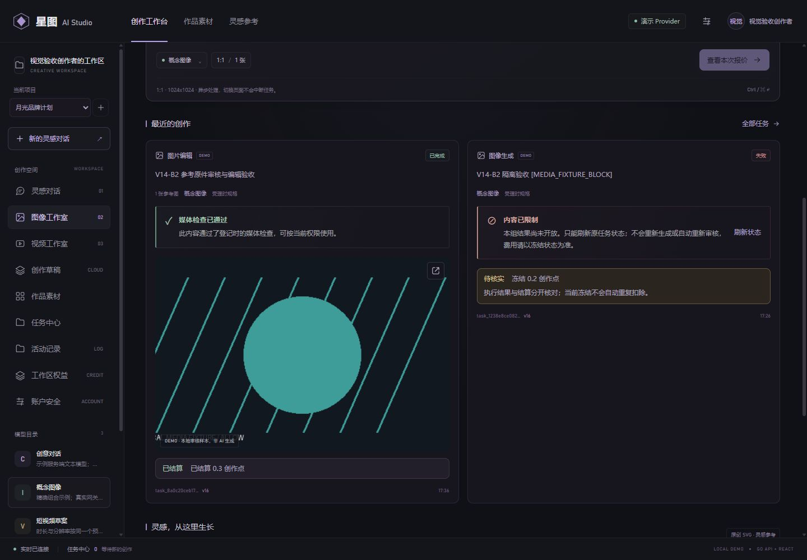

[完整证据](assets/media-moderation-validation-v0.14-2026-11-14.json) · [浏览器](assets/media-moderation-browser-v0.14-2026-11-14.json) · [016升级](assets/media-moderation-upgrade-v0.14-2026-11-14.json) · [视频播放](assets/media-video-phase14.jpg) · [手机隔离](assets/mobile-media-blocked-phase14.jpg) · [058台账](../changes/2026-11-14-058-media-review-integration.md)。真实审核商与V14-C另验，主JS505.19kB仍有分包提示；没有生产容量或公开收费放行。

## 导航

[A3.3公平调度契约](../planning/v16a33-contract.md) · [调度状态与事务](media-scheduler.md) · [HTTP事实与审核许可](media-schedule-transport.md) · [大积压与维护验收](media-scheduler-validation.md) · [ADR0018](decisions/0018-media-fair-scheduling.md)。当前验收状态以[083](../changes/2026-11-15-083-media-scheduler-integration.md)为准。

[A3.2首次审核分派](../planning/v16a32-contract.md)已本地验收；[079](../changes/2026-11-14-079-media-review-dispatch-integration.md)记录独立证据及修正，不沿用v0.18成绩。

设计选择与替代项见[ADR0017](decisions/0017-media-review-dispatch.md)。

实现说明：[首次审核分派](media-review-dispatch.md) · [共享审核许可](media-review-permits.md) · [独立验收及019维护](media-review-dispatch-validation.md)。

| 页面 | 内容 |
| --- | --- |
| [架构与实施边界](architecture.md) | 本地链路、数据所有权、规划与当前差异 |
| [统一文档与目录](repository-layout.md) | docs文档、db SQL及根入口规则 |
| [数据库迁移](database-migrations.md) | 嵌入路径与版本兼容，不变SQL字节 |
| [ADR0014：聊天公平执行](decisions/0014-chat-execution-scheduling.md) | 选择、替代方案、事务边界和测量口径 |
| [聊天公平执行](execution-scheduler.md) | 单写者workspace轮转、预算、原键与取消 |
| [V16-A2媒体通道契约](../planning/v16a2-contract.md) | 提交与查询交付隔离，当前实现与验收边界 |
| [媒体执行通道](media-execution-lanes.md) | 先留预算再领取、PG连接与内存attempt保护 |
| [媒体HTTP通道](media-transport-lanes.md) | submit/query连接隔离及真实HTTP边界 |
| [ADR0015：媒体资源预留](decisions/0015-media-execution-lanes.md) | 先取得预算再claim、替代项与A3阶段边界 |
| [V16分批契约](../planning/v16-contract.md) | A1聊天公平执行、后续媒体隔离与持久流边界 |
| [持续推进](../planning/progress.md) | 完成、当前工作、外部条件与下一批 |
| [开发与交付](development.md) | 环境、运行、验证、文档治理规则 |
| [开发 TODO](../../TODO.md) | 10 个横向模块、23 个纵向批次，验收后逐批勾选 |
| [任务维护](../planning/README.md) | 唯一任务源、生成命令、依赖与完成证据校验 |
| [生成权限与复核](generation-controls.md) | 工作区限制、申诉、预演、公开答复与017 |
| [生成受理门禁](generation-admission.md) | 原幂等优先、最终事务、旧任务继续与moderator |
| [复核工作台](generation-controls-workbench.md) | 用户申请、运营密码确认与未知响应核对 |
| [ADR0013：工作区生成限制](decisions/0013-workspace-generation-controls.md) | 稳定工作区锁、独立角色和复核边界 |
| [媒体审核引擎](media-moderation.md) | 完整私有字节、独立策略、media-v1协议和016 |
| [媒体审核执行](media-moderation-execution.md) | 同步参考、私有候选、整组事务放行和恢复 |
| [媒体审核工作台](media-moderation-workbench.md) | 审核状态、乱序保护、原查询恢复与内容门禁 |
| [ADR0012：媒体批准后交付](decisions/0012-media-review-gate.md) | 私有候选、交付事务、存储与结算边界 |
| [文本审核引擎](moderation.md) | 冻结策略、demo规则、私有text-v1协议与015 |
| [文本审核执行](moderation-execution.md) | 输入准入、候选隔离、事务放行与恢复 |
| [文本审核工作台](moderation-workbench.md) | 全文审核提示、乱序保护与隔离回复 |
| [ADR0011：全文审核后交付](decisions/0011-text-review-gate.md) | 首字延迟取舍、隐私与恢复边界 |
| [运营权限与角色管理](operations-access.md) | 最小工作区角色、密码确认与停机授权 |
| [运营异常工单](operations-cases.md) | 元数据队列、真实预演、事务处置与恢复 |
| [运营核实工作台](operations-workbench.md) | 独立作用域、证据确认、未知响应保护 |
| [ADR 0010：有作用域的运营处置](decisions/0010-scoped-operations.md) | 角色边界、预演与已提交收据 |
| [权益账本与任务结算](ledger.md) | 双分录、同事务、恢复和核账约束 |
| [权益工作台](billing-workbench.md) | 钱包、流水、报价确认及原请求恢复 |
| [权益配置与离线核账](billing-operations.md) | 价格、固定精度、报价、待核实、冲正及012升级 |
| [聊天用量证据](chat-usage.md) | 完整usage、缺失/非法用量和demo边界 |
| [ADR 0009：权益账本](decisions/0009-credit-ledger.md) | 不可变分录、同事务结算和离线控制面 |
| [账户安全与自助恢复](account-security.md) | 一次性令牌、密码版本、会话撤销、私有安全活动与011迁移 |
| [安全邮件投递](mail-delivery.md) | TLS SMTP、加密队列、未知不重发、配置及真实渠道条件 |
| [ADR 0008：账户恢复与邮件](decisions/0008-account-security-and-mail.md) | 凭据竞争、事务发件箱、敏感请求与升级边界 |
| [多轮对话与分支](conversation.md) | 持久消息树、CAS/幂等、显式继续、预算裁剪与010迁移 |
| [结构化聊天Provider](chat-provider.md) | 真实messages、输出预算字段、估算和配置边界 |
| [ADR 0007：会话与上下文](decisions/0007-conversations-and-context.md) | 不可变分支、原子受理、冻结执行与上下文策略 |
| [模型目录与规格](models.md) | 配置示例、版本/ETag、精确参数预设与历史任务快照 |
| [参考素材与图片编辑](references.md) | 私有上传、幂等、权限、有序引用、配额与文件恢复 |
| [Go 后端](backend.md) | 实际 API、Provider、状态与测试 |
| [工作台前端](frontend.md) | 实际界面、交互、API 对接与限制 |
| [持久化与账户](persistence-auth.md) | PostgreSQL、身份/项目权限、检查点与重启恢复 |
| [云端草稿与版本](drafts.md) | 项目保存、不可变历史、并发冲突、幂等与恢复 |
| [审计与活动](audit.md) | 同事务业务记录、脱敏字段、权限和分页边界 |
| [异步媒体网关](media-gateway.md) | 真实图片/视频契约、未知状态、素材导入与配置 |
| [本地数据库](local-database.md) | Windows 便携 PostgreSQL、跨平台配置、隔离验证 |
| [资源准入](admission.md) | 工作区/模型/SSE限额、持久未知任务占用、幂等重放优先 |
| [运行可观测](observability.md) | 存活/就绪、受保护Prometheus指标、请求编号与隐私边界 |
| [性能基线](performance.md) | 可复现本地测量、指标口径与生产验收差距 |
| [路线与放行门槛](roadmap.md) | 按总体方案拆分的 20—24 周路线 |
| [ADR 0001：第一阶段边界](decisions/0001-phase-one.md) | 单进程与内存开发存储的选择及退出条件 |
| [ADR 0002：持久单写者阶段](decisions/0002-durable-single-writer.md) | 持久恢复与真实网关接入的实施顺序 |
| [ADR 0003：模型目录与快照](decisions/0003-versioned-model-catalog.md) | 版本化能力、启动配置与执行身份冻结 |
| [ADR 0004：私有参考与精确正文](decisions/0004-private-reference-bodies.md) | 磁盘流式正文、引用关系、配额及备份边界 |
| [独立资产库](assets.md) | 项目目录、搜索/标签、CAS幂等、历史与回收权限 |
| [私有对象存储](object-storage.md) | 本地/S3配置、私有代理、分段下载、迁移与真实兼容测试 |
| [停机维护与恢复](storage-maintenance.md) | 目录归属、排他锁、可达性、计划摘要与联备恢复 |
| [ADR 0005：私有资产生命周期](decisions/0005-private-library-lifecycle.md) | 独立元数据、不可变内容和保守回收 |
| [持久事件与回放](events.md) | 同事务Outbox、持久feed、范围游标、背压与窗口重置 |
| [任务租约与恢复](scheduler.md) | 数据库领取/续约、epoch/generation隔离、受理不明保护 |
| [ADR 0006：持久通知与任务租约](decisions/0006-durable-events-and-task-leases.md) | 事务顺序、执行者隔离与单控制写者边界 |
| [台账索引](../changes/README.md) | 每个逻辑变更的范围、验证与回滚 |
| [当前 OpenAPI](../api/openapi.yaml) | 已实现接口的请求、响应及错误契约 |

## v0.13 文本审核本地子批次验收

[B1契约](../planning/v14b1-contract.md)和[ADR0011](decisions/0011-text-review-gate.md)已实施。真实PG全量170.241秒、审核PG五组8.853秒、237项前端/24文件、8项治理、vet/TS/构建、六套隔离冒烟及OpenAPI61路径/73操作/344引用通过。真实PG COMMIT确认回包丢失后App重启只恢复已提交决策，原键不重复生成；本专项不是OS Kill测试。

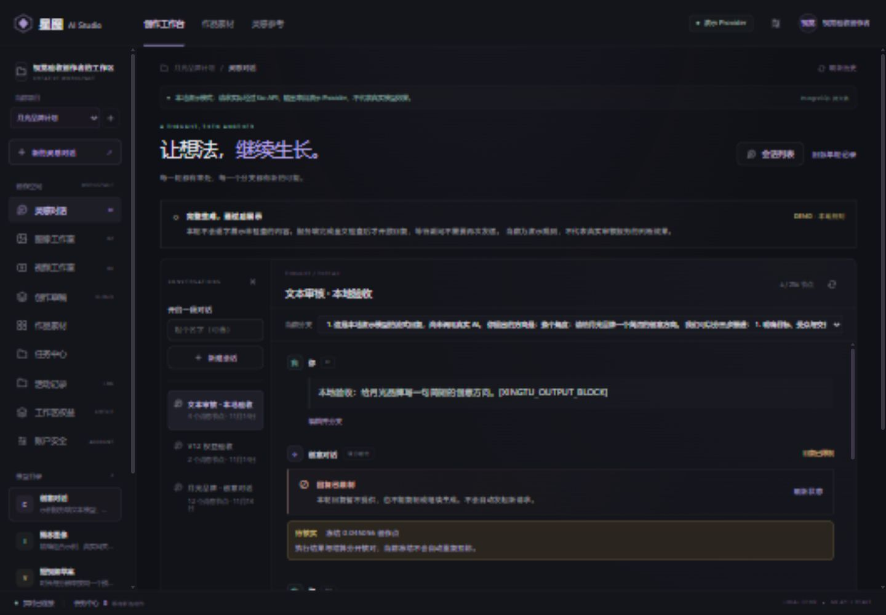

浏览器验证输入拒绝不建消息、保留草稿；输出限制且冻结0.045056演示点待核实；新问题可正常提交，服务端省略受限整轮，纳入1条/省略2条，通过后结算0.000384点。刷新后摘要与正文门禁保留；1440×1000和390×844无横向溢出，console warning/error为0。014→015前联备，旧数据未变化且未自动批准历史资源。

[输入拒绝](assets/moderation-input-phase13.jpg) · [输出限制](assets/moderation-blocked-phase13.jpg) · [手机说明](assets/mobile-moderation-phase13.jpg) · [手机受限回复](assets/mobile-moderation-blocked-phase13.jpg) · [浏览器记录](assets/moderation-browser-v0.13-2026-11-14.json) · [升级比对](assets/moderation-upgrade-v0.13-2026-11-14.json) · [验证汇总](assets/moderation-validation-v0.13-2026-11-14.json) · [性能基线](assets/performance-local-v0.13-2026-11-14.json) · [054台账](../changes/2026-11-14-054-text-review-integration.md)。

用户选择先完成本地闭环，真实审核商尚未选型；规则不代表语义准确率，HTTP模拟器不代表真实渠道。未审候选仅进程内存，无人工重审/放行。启用审核时拒绝新图片/视频生成，历史任务与素材不追溯；B2媒体与V14-C另行推进，完整V14仍进行中、11/23整批完成。

## v0.12 运营异常核实本地子批次验收（历史）

V14-A三项check通过；V14-B/C仍待办，V11真实邮件依赖仍未放行，所以整批保持进行中、已验收仍11/23。真实PG全量169.657秒、217项前端/23文件、8项治理、vet/TS/构建、六套隔离冒烟及OpenAPI61路径/73操作/340引用通过。覆盖实时scope/撤权、当前密码重核、预演/CAS/回滚、原handle只查询及旧租约失效；真实PG提交确认回包丢失后App重启只读回原收据，不重复释放。该专项不是本批OS Kill测试。

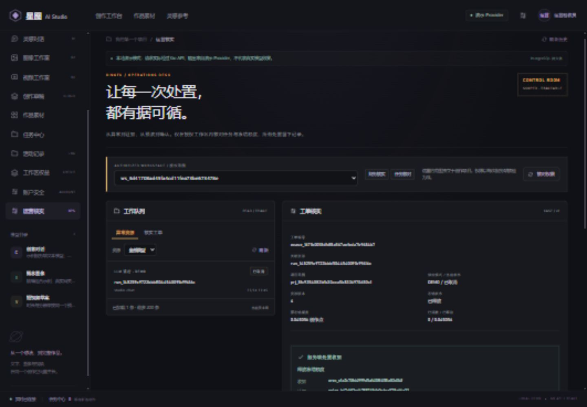

PG/demo浏览器完成异常开单、证据修改、预演、错误密码拒绝、明确提交及收据/审计补读：演示冻结0.045056点释放，未调用真实AI、SMTP或支付。普通用户无入口，运营范围独立于创作项目；390×844与1440×1000没有横向溢出。012→014前完成联备，旧资产/草稿/会话/运行及分录保留，未自动授权。

[桌面预演](assets/operations-plan-phase12.jpg) · [手机收据](assets/mobile-operations-phase12.jpg) · [手机预演](assets/mobile-operations-plan-phase12.jpg) · [浏览器记录](assets/operations-browser-v0.12-2026-11-14.json) · [升级比对](assets/operations-upgrade-v0.12-2026-11-14.json) · [验证汇总](assets/operations-validation-v0.12-2026-11-14.json) · [性能基线](assets/performance-local-v0.12-2026-11-14.json) · [050台账](../changes/2026-11-14-050-operations-integration.md)。生产容量、MFA/双人审批、真实支付及多实例仍未验收。

## v0.11 权益账本联合验收（历史）

2026-11-14，根真实PG全量studio148.283秒、202项前端/22文件、8项治理、vet/严格TS/构建、六套隔离冒烟通过。OpenAPI 54路径/65操作/67 schemas/311引用有效。覆盖并发冻结、原键重放、回滚、COMMIT确认不明、HTTP usage到PG、实际Kill恢复与离线冲正核账。011→012升级前完成数据库与私有目录联备，旧资产/修订/草稿/会话保留，无自动赠额或旧资源追扣。

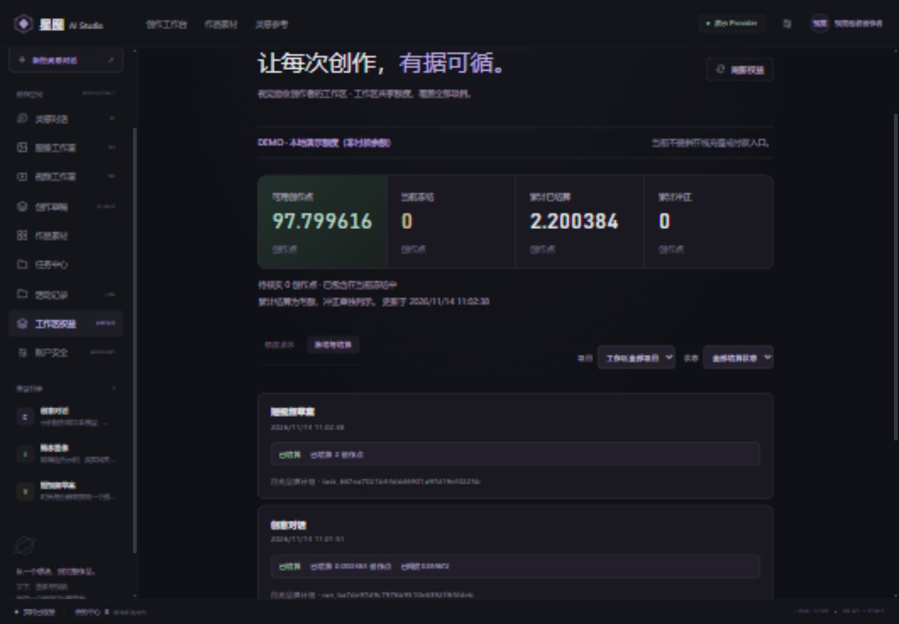

PG/demo浏览器完成图片0.2点、聊天0.000384点、视频海报2点结算，剩余97.799616点；输入变更使原报价失效。390×844钱包与报价无横向溢出，console warning/error为0。权益账本已验收；真实支付、真实供应商成本、全站多实例及生产容量仍未验收。

[桌面报价](assets/billing-quote-phase11.jpg) · [手机权益](assets/mobile-billing-phase11.jpg) · [手机报价](assets/mobile-billing-quote-phase11.jpg) · [浏览器记录](assets/billing-browser-v0.11-2026-11-14.json) · [升级比对](assets/billing-upgrade-v0.11-2026-11-13.json) · [性能基线](assets/performance-local-v0.11-2026-11-14.json) · [046台账](../changes/2026-11-13-046-billing-integration.md)。

## v0.10 账户安全本地验收（历史）

根真实PG全量115.317秒、173项前端/21文件、8项治理、vet/严格TS/构建、六套隔离冒烟与OpenAPI 50路径/61操作/293引用通过。真实本机TLS邮件完成验证/找回/改密HTTP链；DATA后实际Kill重启停在SUBMIT_UNKNOWN，不自动重发。真实外部渠道未验收，V11三项本地check通过、实际渠道blocked，仍10/23整批完成。

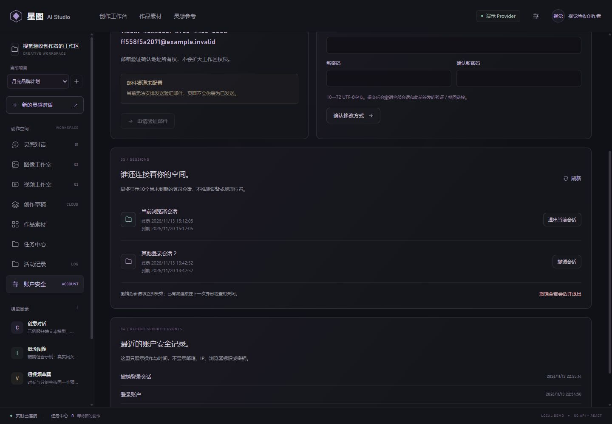

[手机安全](assets/mobile-account-security-phase10.jpg) · [手机会话](assets/mobile-account-sessions-phase10.jpg) · [找回渠道禁用](assets/account-recovery-disabled-phase10.jpg) · [浏览器记录](assets/account-security-browser-v0.10-2026-11-13.json) · [升级前后比对](assets/account-security-upgrade-v0.10-2026-11-13.json) · [性能口径](assets/performance-local-v0.10-2026-11-13.json)。开发库001—011，旧Cookie、草稿v5、资产修订10和12节点对话保留；未发真实邮件/付费请求，下一步V12精确账本。详见[042](../changes/2026-11-13-042-account-security-integration.md)。

## v0.9 多轮对话集成验收

根真实PG全量studio82.959秒、前端154项/19文件、治理8项、vet/TS/构建、六套隔离冒烟和OpenAPI 41路径/52操作/267引用通过。实际杀进程保留部分回答与消息树，原键恢复不重发，明确继续才新增上游请求；HTTP fixture验证三条结构化消息、分支隔离及完整旧轮裁剪。最终独立静态复核未发现阻断，修复记录见[038](../changes/2026-11-13-038-conversation-integration.md)。

[双窗口输入保护](assets/conversations-dirty-phase9.jpg) · [手机对话](assets/mobile-conversations-phase9.jpg) · [手机输入区](assets/mobile-conversations-composer-phase9.jpg) · [浏览器记录](assets/conversations-browser-v0.9-2026-11-13.json) · [上下文网关fixture](assets/conversation-smoke-v0.9-2026-11-13.json) · [本地性能](assets/performance-local-v0.9-2026-11-13.json)。开发库001—010、旧草稿v5及资产修订v10确认；继续单控制写者，未调用真实收费模型。输入/未知请求仅当前页面内存，选择ID持久化不等于离线草稿恢复；估算不能用于真实计费。

## v0.8 持久事件与任务租约集成验收

根真实PG全量studio66.419秒、前端135项/18文件、治理8项、vet/TS/构建、五套隔离冒烟通过。实际子进程Kill后只提交一次供应商POST，原幂等和崩溃前通知游标恢复；COMMIT确认丢失、租约失效和背压分别验证。独立复审的缓存竞态与超过256项补读循环已修复。完整证据见[034](../changes/2026-11-13-034-durable-execution-integration.md)。

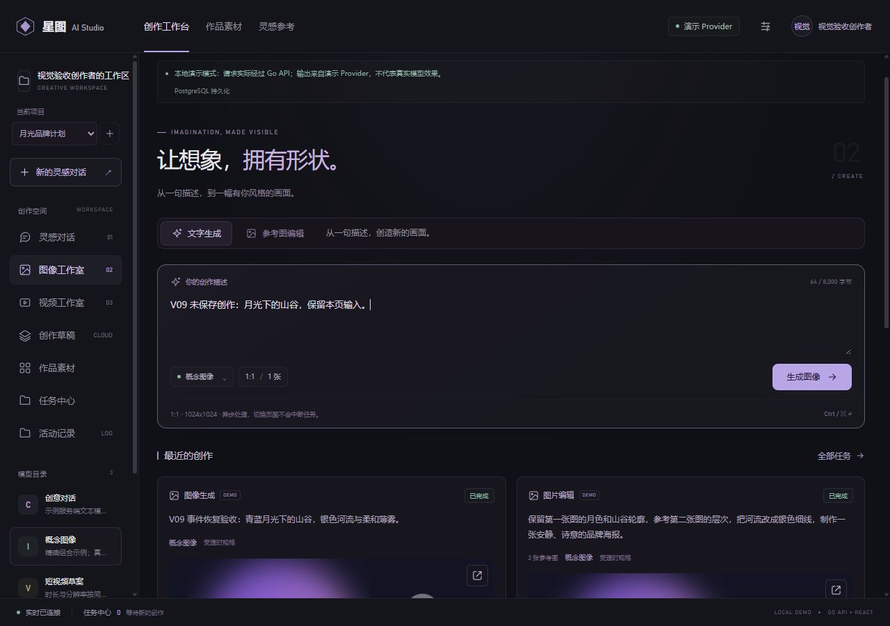

[编辑保护](assets/events-dirty-phase8.png) · [手机布局](assets/mobile-events-phase8.png) · [浏览器记录](assets/events-browser-v0.8-2026-11-13.json) · [本地性能](assets/performance-local-v0.8-2026-11-13.json)。升级前停机联备，开发库001—009核对通过。双窗口同步不覆盖正在输入的内容；初始reset后按需补读，无自动重新生成。LLM逐token持久日志、浏览器ACK与全站多实例未完成，继续保持单控制写者。

## v0.7 历史资产库集成验收

真实PG全量129个Go测试函数及子例通过（studio42.534秒），独立真实S3兼容服务2项最终复验0.273秒。覆盖目录注册/审计回滚、CAS并发、原键重放、旧库回填、旧下载拒绝、回收恢复及数据库身份防错库维护。前端、构建、五套冒烟、OpenAPI和浏览器完整证据见[030](../changes/2026-11-13-030-asset-library-integration.md)。

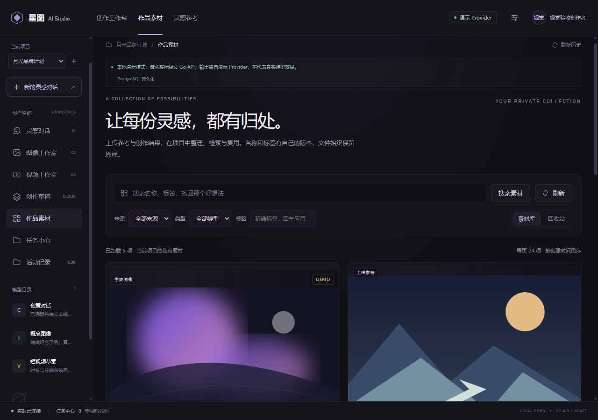

[手机素材详情](assets/mobile-library-phase7.png) · [浏览器记录](assets/library-browser-v0.7-2026-11-13.json) · [资产库冒烟](assets/library-smoke-v0.7-2026-11-13.json) · [真实S3兼容服务](assets/object-storage-v0.7-2026-11-13.json)。回收不永久清除内容，历史仅为元数据；参考图/编辑正文与收据仍依赖私有目录，尚不是无状态多实例。生产云权限、容灾和真实AI另行验收。

## v0.6 历史本地集成验收

106个Go测试函数及子例、真实PG全量25.156秒、前端100项、治理8项、vet/TS/构建、四套隔离冒烟通过。覆盖上传真实格式/配额/权限、精确编辑正文、事务回滚、目录停用后的原字节恢复、停机查询保护和006格式栅栏。OpenAPI29路径/36操作/139引用核对通过。真实供应商仍未验收，V07不提前勾选。

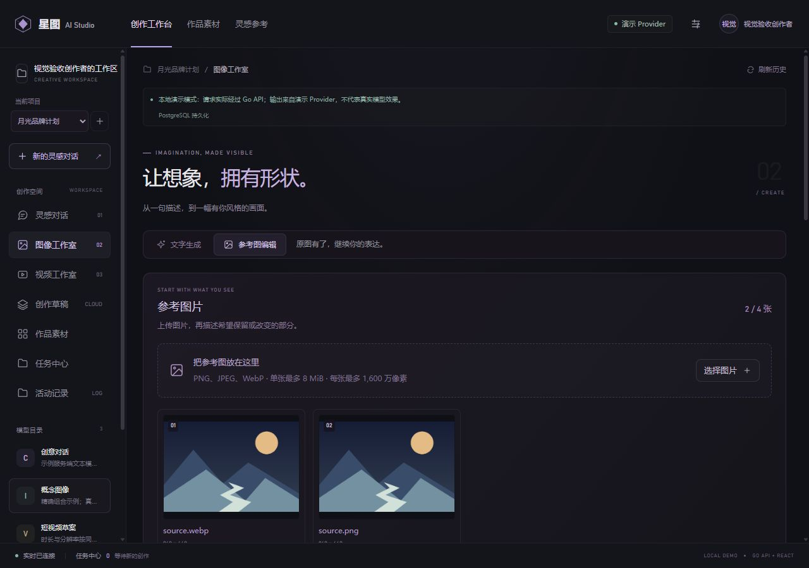

[手机参考素材](assets/mobile-references-phase6.jpg) · [浏览器验收](assets/references-browser-v0.6-2026-11-13.json) · [参考素材冒烟](assets/reference-smoke-v0.6-2026-11-13.json) · [运行冒烟](assets/runtime-smoke-v0.6-2026-11-13.json) · [目录冒烟](assets/catalog-smoke-v0.6-2026-11-13.json)。升级前备份、故障修复及限制见[025](../changes/2026-11-13-025-reference-integration.md)。512px服务端缩略图避免列表解码大原图；编辑正文采用磁盘流式处理，实际生产容量仍需独立测量。

## v0.5 历史集成验收

Go81个测试函数及子例、真实PG全量14.699秒、前端85项、治理8项、vet/TS/构建、三套隔离冒烟通过。目录鉴权先于304，版本过期拒绝新请求，完整规格组合校验，旧幂等重放先于目录启停。历史任务保留原名称/能力/参数，live媒体受理时冻结原提交字节。共享HTTP客户端的并发模型隔离及连接复用通过fixture验证。

开发库已有001—004增量升级005，备份保留；旧二进制遇到005拒绝启动，避免写丢新JSON字段。浏览器确认旧项目、任务、云端草稿v5仍在，新任务按新规格受理；独立目录实例验证多模型、中文字节超限、视频10秒/1080p/9:16、停用刷新与输入保留。390×844手机尺寸无横溢，未替代实机测试。

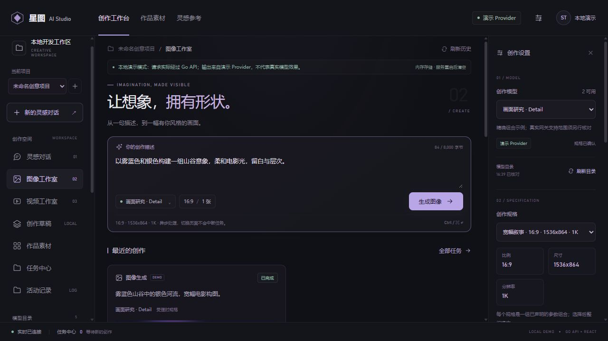

[手机模型设置](assets/mobile-models-phase5.jpg) · [视频预设](assets/video-presets-phase5.jpg) · [目录停用反馈](assets/catalog-update-phase5.jpg) · [持久工作台](assets/workbench-phase5.jpg)。证据见[021](../changes/2026-11-13-021-model-integration.md)、[目录冒烟](assets/catalog-smoke-v0.5-2026-11-13.json)、[运行冒烟](assets/runtime-smoke-v0.5-2026-11-13.json)及[性能页](performance.md)。目录需重启生效，不是热更新；未执行真实付费生成。

## v0.4 历史集成验收

Go65个测试函数及子例、真实PG全量、前端70项、治理8项、vet/TS/构建、既有冒烟与新增运行冒烟通过。已验证工作区/模型限额、满载幂等优先、未知任务占用与重启、指标权限/脱敏、SSE释放/慢消费者；大文件ReaderFrom优化路径与SSE Flush/deadline保留。开发库升级前已备份，迁移004与两个部分索引确认。

浏览器完成真实PG容量、模型明细、390×844无横溢、独立小限额429/冷却/输入保留/手动恢复；关闭侧栏23秒服务端runtime计数不增长。证据见[017](../changes/2026-11-13-017-runtime-integration.md)、[冒烟报告](assets/runtime-smoke-v0.4-2026-11-13.json)与[性能页](performance.md)。

[手机容量](assets/mobile-runtime-phase4.jpg) · [满载与冷却](assets/admission-phase4.jpg)。没有真实付费请求或生产容量声明。

## v0.3 历史集成验收

Go46个测试函数及子例、真实PG全量、前端57项、治理8项测试、vet/TS/构建/冒烟通过；OpenAPI22路径/26操作/78引用核对通过。完成双窗口冲突、旧稿恢复为新版、会话失效重登录保留编辑、项目隔离、实际服务重启和390×844手机尺寸检查。审计失败注入验证业务/幂等回滚，取消/核对失败不替换内存或广播。

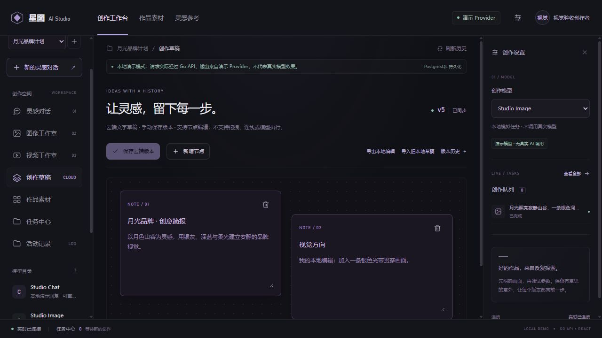

[活动记录](assets/activity-phase3.jpg) · [冲突提示](assets/draft-conflict-phase3.jpg) · [手机草稿](assets/mobile-drafts-phase3.jpg) · [手机活动](assets/mobile-activity-phase3.jpg)。详细环境、边界和开发期间修复见[013台账](../changes/2026-11-13-013-batch-integration.md)。

## v0.2 历史集成验收

Go31个测试函数及子用例、真实PostgreSQL18.7集成、Go vet、前端36项测试/严格TS/构建通过。已验证账户和项目权限、持久幂等、重启恢复、静默流失锁停止、原任务核对与供应商停用后的私有资产读取。OpenAPI18路径/21操作/60引用核对通过。

浏览器确认桌面与390×844手机尺寸登录/退出、创建及切换项目、任务和对话；重启实际Go服务后仍保留会话、项目选择、原任务和对话输出。最终控制台无warning/error，临时手机viewport已恢复。原始基线及限制见[性能页](performance.md)，集成证据见[007](../changes/2026-11-13-007-integration-database.md)。

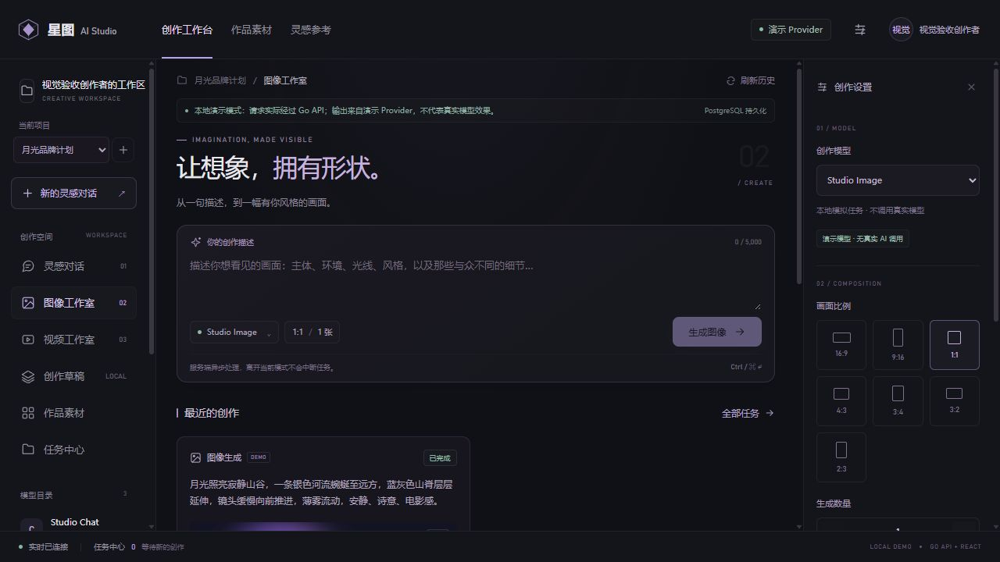

[登录页截图](assets/login-phase2.jpg) · [手机任务页截图](assets/mobile-phase2.jpg)

## v0.1 历史验收

2026-11-13：Go、前端与文档治理检查已通过，并用独立临时 demo 服务验证流输出、幂等、媒体任务、结果获取和取消。浏览器实际检查了 1280×720 桌面及 390×844 手机尺寸，确认聊天输出、图片任务、视频取消、刷新恢复和草稿本地保存；手机尺寸模拟不等于移动实机验收。当前没有真实 AI 调用或容量压测。

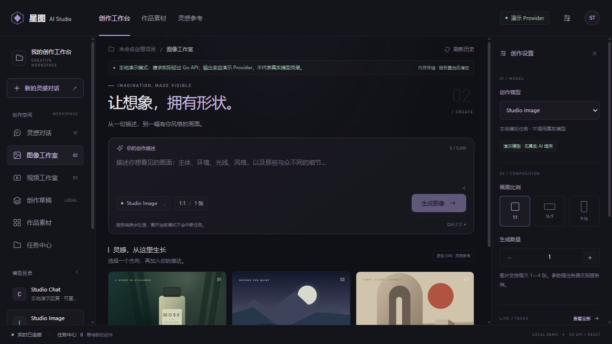

具体命令、环境限制与修正记入 [001 集成台账](../changes/2026-11-13-001-foundation.md)及模块台账。Go race 本机受 CGO/C 编译器环境限制，已配置 Linux CI，尚未远程执行。

## 文档维护规则

所有代码、配置、依赖、测试、文档、规则和脚本变更都必须建立或更新相应台账，同时同步[仓库 README](../../README.md)和相关 Wiki。完整约束见 [AGENTS.md](../../AGENTS.md)。同一逻辑变更在交付前的修正可追加同一记录；交付后的新变更另建记录，不能覆盖历史掩盖变更。

文档必须区分“已实现”“当前限制”“计划”，测试结果写明实际命令与观察结果。未运行的测试、待确认的网关能力和性能假设不得写成已完成事实。[文档检查脚本](../../scripts/check-docs.mjs)检查文件、链接、台账结构及变更集合中的同步痕迹；语义是否正确、每项修改是否都被解释，仍需人工审阅。

## 最近变更

- [259 · 定速媒体受理与完整生命周期](../changes/2026-11-24-259-openloop-media-lifecycle.md)
- [258 · 受管聊天 1,024 路并发对照](../changes/2026-11-24-258-managed-chat-1024.md)
- [257 · 正常受理任务的多轮原查询](../changes/2026-11-24-257-recurring-original-query.md)
- [256 · 同一服务的混合运行与重启核验](../changes/2026-11-24-256-mixed-service-soak.md)
- [255 · 原查询预选的公平页对照](../changes/2026-11-24-255-original-query-page.md)
- [254 · 六万项正常媒体受理及原库重开](../changes/2026-11-24-254-normal-admission-60000.md)
- [253 · 受管模型全执行位联合验收](../changes/2026-11-23-253-managed-chat-512.md)
- [252 · 准入配额与原库恢复扫描](../changes/2026-11-23-252-admission-thresholds-and-recovery.md)
- [251 · 040 同源程序累计回归](../changes/2026-11-23-251-format-040-regression.md)
- [250 · 原查询结果合批的实库对照](../changes/2026-11-23-250-known-query-save-batch.md)
- [249 · 原任务查询的并发登记](../changes/2026-11-23-249-large-query-entry-pin.md)
- [248 · 原任务查询的分段耗时](../changes/2026-11-23-248-query-stage-timing.md)
- [247 · 窄屏报价的完整原片编号](../changes/2026-11-23-247-source-quote-narrow.md)
- [246 · 经正式接口受理的媒体在途任务](../changes/2026-11-23-246-normal-media-admission-capacity.md)
- [245 · 039 至 040 的原任务恢复与渠道探测](../changes/2026-11-23-245-media-query-format-restore.md)
- [244 · 大档原任务查询与有界派发](../changes/2026-11-23-244-large-original-query.md)
- [243 · 039 本机累计回归](../changes/2026-11-23-243-format-039-regression.md)
- [242 · 媒体原任务查询的独立 PostgreSQL 连接预算](../changes/2026-11-23-242-query-lease-pool.md)
- [241 · 媒体原 handle 查询的到期与发起延迟](../changes/2026-11-23-241-media-original-query-capacity.md)
- [240 · 受管模型执行容量与 264 路联合入口](../changes/2026-11-23-240-managed-chat-capacity.md)
- [239 · 真实浏览器的原视频报价与受理恢复](../changes/2026-11-23-239-source-video-browser.md)
- [238 · 原视频操作与停写联备验收](../changes/2026-11-23-238-source-video-integration-restore.md)
- [237 · 项目事件按游标共享已提交的通知页](../changes/2026-11-23-237-shared-project-feed.md)

- [236 · 视频工作室选择原片、报价和查询原收据](../changes/2026-11-23-236-source-video-workbench.md)
- [234 · 冻结私有原视频的网关请求](../changes/2026-11-23-234-source-video-provider.md)
- [233 · 真实项目 SSE 广播与断线恢复](../changes/2026-11-23-233-project-sse-fanout.md)
- [232 · 授权订阅的分页会话复核](../changes/2026-11-23-232-paged-stream-session-admission.md)

- [235 · 私有原视频编辑与延长受理](../changes/2026-11-22-235-video-source-admission.md)

- [231 · 按用户选择暂缓正式支付接入](../changes/2026-11-22-231-payment-channel-deferred.md)

- [230 · 根任务导航显示已验证子项与最新台账](../changes/2026-11-22-230-todo-entry-acceptance.md)

- [229 · 单镜视频窄屏表单标签对比度](../changes/2026-11-22-229-panel-video-label-contrast.md)

- [228 · 共享会话批量复核的返回位置](../changes/2026-11-22-228-stream-session-batch-positions.md)

- [227 · 037 与 038 本地制品复验](../changes/2026-11-22-227-local-acceptance.md)

- [222 · 已确认分镜的视频报价与受理](../changes/2026-11-22-222-comic-panel-video.md) · [223 · 分镜产物替换指定剪辑镜头](../changes/2026-11-22-223-panel-video-timeline-replacement.md) · [224 · 工作台单镜生成与原键核对](../changes/2026-11-22-224-panel-video-workbench.md)

- [221 · 账户切换后的首个草稿输入](../changes/2026-11-22-221-account-composer-scope.md)

- [225 · 固定分镜生成与局部重做集成](../changes/2026-11-22-225-panel-video-integration.md)

- [220 · 80 个模型流、241 个订阅与批量持久化联合验收](../changes/2026-11-22-220-integrated-chat-sse-acceptance.md)

- [219 · 192 个授权订阅、撤销与重连](../changes/2026-11-22-219-authenticated-sse-sessions.md)

- [216 · 036 到 037 的跨格式回退演练](../changes/2026-11-22-216-cross-format-recovery.md) · [217 · 同步备机切换与原业务收据](../changes/2026-11-22-217-postgresql-sync-standby.md)

- [218 · 共享会话核验与全局订阅容量](../changes/2026-11-22-218-stream-session-batches.md)

- [215 · 037 制品与 SPDX 复核](../changes/2026-11-22-215-release-evidence-037.md)

- [214 · 真实慢 TCP 读者与订阅上限](../changes/2026-11-22-214-sse-socket-acceptance.md)

- [213 · 长回复虚拟行与原提示滚回核对](../changes/2026-11-22-213-virtualized-live-reply-observation.md)

- [212 · 真实工作台增量批量提交集成](../changes/2026-11-22-212-business-delta-batch-integration.md)

- [209 · 原增量表的跨运行 PostgreSQL 提交](../changes/2026-11-22-209-batched-run-delta-store.md) · [210 · 跨运行增量的有界协调与开关](../changes/2026-11-22-210-run-delta-coordinator.md) · [211 · 真实聊天流的批量提交前后对照](../changes/2026-11-22-211-batched-delta-acceptance.md)

- [208 · 受管聊天执行的集成与故障验收](../changes/2026-11-22-208-managed-chat-integration.md)

- [207 · 受管会话的授权 SSE 与真实进程归属验收](../changes/2026-11-22-207-managed-chat-acceptance.md)

- [205 · 私管道的受管聊天执行进程](../changes/2026-11-22-205-chat-execution-child-transport.md) · [206 · 受管与本地执行共用调度预算](../changes/2026-11-22-206-managed-chat-scheduling.md)

- [204 · 运行 SSE 断线回放的只读连接隔离](../changes/2026-11-22-204-run-replay-read-pool.md)

- [203 · PR 启动资源预算与制品差异](../changes/2026-11-22-203-pr-bundle-diff.md)

- [202 · 分片批量持久日志与并发回放试验](../changes/2026-11-22-202-sharded-stream-journal-poc.md)

- [201 · 64 个同时活跃的模型流和授权 SSE](../changes/2026-11-22-201-active-stream-capacity.md)

- [199 · 启动 JavaScript 实际 gzip 传输](../changes/2026-11-22-199-startup-javascript-compression.md)

- [200 · 受限网络下的冷暖工作台与深历史](../changes/2026-11-22-200-workbench-network-browser.md)

登录 PostgreSQL 工作台，在「创作草稿 → 自由画布」可编辑节点、连接和分组，保存修订，并查看本项目的私有图片和运行状态。[数据与使用范围](decisions/0037-project-canvas.md)。

- [195 · 项目画布保存与私有来源](../changes/2026-11-22-195-project-canvas-versions.md) · [196 · 自由画布的编辑与无障碍操作](../changes/2026-11-22-196-free-canvas-workbench.md) · [197 · 两档真实图的平移测量](../changes/2026-11-22-197-canvas-pan-browser.md) · [198 · 画布集成、精确格式与恢复](../changes/2026-11-22-198-project-canvas-integration.md)

使用 PostgreSQL 时可显式开启长会话。本机已验证一条分支 5,000 轮、500 页及淘汰后的原文重读。默认配置仍按 128 个分支节点受理新写入。[配置与恢复](decisions/0036-long-conversations.md)。

- [191 · 可回读的消息正文缓存](../changes/2026-11-22-191-chat-message-body-cache.md) · [192 · 持久会话祖先与上下文](../changes/2026-11-22-192-durable-conversation-ancestry.md) · [193 · 长会话配置、格式与恢复](../changes/2026-11-22-193-long-history-format-and-restore.md) · [194 · 真实万条分支验收](../changes/2026-11-22-194-deep-conversation-acceptance.md)

本机已验收单分支 128 条消息的连续翻页、键盘导航和窄屏阅读；前插或改变宽度时，原消息锚点最大偏移约 0.14 CSS 像素。[浏览器与数据库实测](assets/performance-conversation-history-035.json)。

本机 PostgreSQL 和 Chromium 已完成一次连续 30 分钟的聊天。30 次检查点均见正文增长，重开原库能读回全部 25,214 字节。[实际样本](assets/performance-long-reply-035.json)。

- [187 · 可变行高的消息列表](../changes/2026-11-22-187-variable-height-chat-timeline.md) · [188 · 按页读取持久会话正文](../changes/2026-11-22-188-conversation-message-pages.md) · [189 · 128条分支消息的浏览器验收](../changes/2026-11-22-189-persistent-conversation-history-browser.md)

- [190 · 前端放行指标与待验范围](../changes/2026-11-22-190-frontend-acceptance-coverage.md)

- [183 · 持久会话 30 分钟回复验收](../changes/2026-11-22-183-durable-long-reply.md) · [184 · 标准服务聊天执行期限](../changes/2026-11-22-184-chat-run-timeout.md) · [185 · 可核对的本机长回复流](../changes/2026-11-22-185-long-reply-gateway-and-observation.md) · [186 · 活跃回复中的可信输入和滚动](../changes/2026-11-22-186-long-reply-browser.md)

- [180 · 万条作品索引及项目切换实测](../changes/2026-11-22-180-private-library-browser-resources.md)

- [182 · 剪辑稿保存回执与选择框同步](../changes/2026-11-22-182-video-timeline-selection.md)

- [181 · 作品库可见卡片与退出清理](../changes/2026-11-22-181-library-virtual-grid.md)

- [本地安全与升级验收证据](release-security-evidence.md) · [179 台账](../changes/2026-11-22-179-local-release-security-evidence.md)

- [177 · 资金、权益与新库恢复](../changes/2026-11-22-177-order-payment-integration.md)

- [工作台制品依赖、许可证及缺项](release-dependencies.md) · [178 记录](../changes/2026-11-22-178-release-sbom.md)

- [按工作区比较归一商户资料和原订单](decisions/0033-order-intents.md#商户资料只读比对) · [173 记录](../changes/2026-11-22-173-offline-order-reconciliation.md)

- [桌面和窄屏的真实浏览器测量](../changes/2026-11-22-171-workbench-frontend-benchmark.md) · [混合负载进程、数据库与订阅观测](../changes/2026-11-22-172-mixed-resource-observation.md)

项目协作与漫剧分镜均已完成本机累计验收。032 全量 PostgreSQL 1639.820 秒通过，覆盖已修正的内容申诉准备和 MP4 下载清理两项。[032 验收](../changes/2026-11-22-156-project-collaboration-integration.md)

- [170 · 三账户客服工单与撤权后恢复](../changes/2026-11-22-170-support-ticket-integration.md)

- [164 · 本人资料下载联验](../changes/2026-11-22-164-personal-data-export-integration.md)

- [160 · 本人订单意向与恢复](../changes/2026-11-22-160-order-intent-integration.md)

- [156 · 站内邀请、角色和多人草稿](../changes/2026-11-22-156-project-collaboration-integration.md)

- [165 · 申诉所需的原审核完成证据](../changes/2026-11-22-165-content-appeal-fixture-completion.md) · [166 · 导出临时目录清理检查](../changes/2026-11-22-166-video-export-cleanup-verification.md)

- [161 · 分阶段的单进程资源测量](../changes/2026-11-22-161-owned-resource-sampling.md)

- [152 · 分镜本、作者确认与 PPTX](../changes/2026-11-22-152-comic-integration.md)

- [148 · 私有剪辑、实际成片与恢复](../changes/2026-11-22-148-video-edit-integration.md) · [142 · 本机双制品交接实测](../changes/2026-11-22-142-release-handoff-integration.md)
- [099 · 持久聊天流升级、故障与联备集成](../changes/2026-11-21-099-run-stream-integration.md)
- [098 · 原游标回放与活动 SSE 交接](../changes/2026-11-21-098-run-stream-replay.md)
- [097 · 聊天执行、取消与审核门禁](../changes/2026-11-21-097-run-stream-execution.md)
- [096 · 021 聊天增量与快照事务](../changes/2026-11-21-096-run-stream-store.md)
- [095 · 聊天增量持久化与断线回放的实施契约](../changes/2026-11-21-095-durable-run-stream-plan.md)
- [094 · 有界缓存与完整启动联合验证](../changes/2026-11-21-094-bounded-startup.md)
- [093 · PG 工作区项目查询与创建上限](../changes/2026-11-21-093-workspace-project-queries.md)
- [092 · 媒体领取与在途缓存占位](../changes/2026-11-21-092-media-cache-pins.md)
- [091 · 聊天执行与活动 SSE 的缓存占位](../changes/2026-11-21-091-run-cache-pins.md)

- [090 · PG 媒体受理与缓存容量分离](../changes/2026-11-21-090-pg-media-cache-admission.md)

- [089 · A4.1 恢复故障与完整启动联合验证](../changes/2026-11-21-089-recovery-acceptance.md)

- [086 · 分页恢复与先行generation栅栏（实施/待验）](../changes/2026-11-15-086-paged-recovery.md)
- [087 · 完整启动分页恢复独立验收（实施/待验）](../changes/2026-11-15-087-recovery-validation.md)
- [088 · 完整启动恢复故障验收（实施/待验）](../changes/2026-11-15-088-recovery-faults.md)
- [085 · 恢复私有阶段批读](../changes/2026-11-15-085-recovery-private-phases.md) · [专项](recovery-private-phases.md) · [ADR 0019](decisions/0019-recovery-private-snapshot.md)
- [059：生成权限与复核核心](../changes/2026-11-14-059-generation-controls.md)
- [060：新生成准入与角色](../changes/2026-11-14-060-generation-admission.md)
- [061：复核工作台与恢复保护](../changes/2026-11-14-061-generation-controls-workbench.md)
- [062：V14-C1联合验收](../changes/2026-11-14-062-generation-controls-integration.md)
- [055：媒体策略与私有字节](../changes/2026-11-14-055-media-moderation-engine.md)
- [056：媒体执行与交付事务](../changes/2026-11-14-056-media-moderation-execution.md)
- [057：媒体审核工作台](../changes/2026-11-14-057-media-moderation-workbench.md)
- [058：V14-B2联合验收](../changes/2026-11-14-058-media-review-integration.md)

- [047 · 运营权限与角色治理](../changes/2026-11-14-047-operations-access.md)
- [048 · 异常工单与预演处置](../changes/2026-11-14-048-operations-cases.md)
- [049 · 运营异常核实工作台](../changes/2026-11-14-049-operations-workbench.md)

- [050 · V14-A运营异常核实联合验收](../changes/2026-11-14-050-operations-integration.md)

- [043 · 权益账本核心](../changes/2026-11-13-043-credit-ledger.md)
- [044 · LLM结构化用量](../changes/2026-11-13-044-provider-usage.md)
- [045 · 工作区权益与报价确认](../changes/2026-11-13-045-billing-workbench.md)
- [046 · V12权益账本联合验收](../changes/2026-11-13-046-billing-integration.md)

- [039 · 账户安全与自助恢复](../changes/2026-11-13-039-account-security.md)
- [040 · 加密安全邮件与SMTP](../changes/2026-11-13-040-security-mail.md)
- [041 · 账户安全工作台](../changes/2026-11-13-041-account-security-workbench.md)
- [042 · V11账户安全本地联合验收](../changes/2026-11-13-042-account-security-integration.md)

- [035 · 持久会话与不可变消息树](../changes/2026-11-13-035-conversation-core.md)
- [036 · 多消息Provider与上下文预算](../changes/2026-11-13-036-chat-provider.md)
- [037 · 多轮对话工作台](../changes/2026-11-13-037-conversations-workbench.md)
- [038 · V10联合验收](../changes/2026-11-13-038-conversation-integration.md)

- [031 · 持久事件与断点回放](../changes/2026-11-13-031-durable-events.md)
- [032 · 任务租约与隔离](../changes/2026-11-13-032-task-leases.md)
- [033 · 事件补齐工作台](../changes/2026-11-13-033-durable-events-client.md)
- [034 · V09联合验收](../changes/2026-11-13-034-durable-execution-integration.md)

- [026 · 独立资产目录与元数据版本](../changes/2026-11-13-026-asset-library.md)
- [027 · 私有对象存储与迁移](../changes/2026-11-13-027-object-storage.md)
- [028 · 资产库工作台](../changes/2026-11-13-028-library-workbench.md)
- [029 · 离线维护与目录归属](../changes/2026-11-13-029-storage-maintenance.md)
- [030 · V08联合验收](../changes/2026-11-13-030-asset-library-integration.md)

- [025 · V07参考素材与图片编辑（开发中）](../changes/2026-11-13-025-reference-integration.md)

- [018：版本化目录与执行快照](../changes/2026-11-13-018-model-catalog.md)
- [019：模型映射与精确上游参数](../changes/2026-11-13-019-model-provider.md)
- [020：模型与规格工作台](../changes/2026-11-13-020-model-workbench.md)
- [021：V06联合验收](../changes/2026-11-13-021-model-integration.md)

- [014：工作区与模型准入](../changes/2026-11-13-014-resource-admission.md)
- [015：健康与运行指标](../changes/2026-11-13-015-observability.md)
- [016：容量与请求反馈](../changes/2026-11-13-016-runtime-workbench.md)
- [017：V05联合验收](../changes/2026-11-13-017-runtime-integration.md)
- [009：模块、批次与 TODO 治理](../changes/2026-11-13-009-batch-tracking.md)
- [010：云端草稿与不可变版本](../changes/2026-11-13-010-project-drafts.md)
- [011：云端草稿与活动工作台](../changes/2026-11-13-011-drafts-activity-workbench.md)
- [012：事务审计与活动记录](../changes/2026-11-13-012-transactional-audit.md)
- [013：v0.3 批次联合验收](../changes/2026-11-13-013-batch-integration.md)
- [004：PostgreSQL 与账户](../changes/2026-11-13-004-persistence-auth.md)
- [005：实际异步媒体协议](../changes/2026-11-13-005-media-gateway.md)
- [006：账户和项目工作台](../changes/2026-11-13-006-accounts-projects.md)
- [007：数据库开发环境与集成](../changes/2026-11-13-007-integration-database.md)
- [008：本地性能基线](../changes/2026-11-13-008-performance-baseline.md)
- [001：工程基础、Wiki 与文档治理](../changes/2026-11-13-001-foundation.md)
- [002：Go API 与 Provider 链路](../changes/2026-11-13-002-go-core.md)
- [003：React 工作台与接口集成](../changes/2026-11-13-003-workbench.md)

## v0.15 / V14-C1 本地验收

[C1范围与契约](../planning/v14c1-contract.md) · [062联合台账](../changes/2026-11-14-062-generation-controls-integration.md)。普通用户与moderator的复核路径独立于既有财务工单，限制仅约束新生成。

297项前端/28文件、8治理、Go vet/构建、真实PG全量282.020s、六套隔离smoke与OpenAPI71路径/83操作/411引用通过。016→017联备保旧，限制→申请→授权预演→解除及答复→手动新生成在桌面/390手机验证。详情见[验证汇总](assets/generation-controls-validation-v0.15-2026-11-14.json)、[浏览器](assets/generation-controls-browser-v0.15-2026-11-14.json)、[升级](assets/generation-controls-upgrade-v0.15-2026-11-14.json)和[062](../changes/2026-11-14-062-generation-controls-integration.md)。

C1只是未来生成限制；C2账户/内容申诉与C3自动额度风控待办，真实渠道另验。首页JS494.93kB已拆出用户/运营页面，无500kB提示；仍无生产容量结论。

## v0.16执行调度验收

301项前端/29文件、10项治理、Go vet/构建、PG全量238.022s、五项独立PG8.777s、六套隔离冒烟通过；11固定指标不含私有身份，媒体lane/持久流留后续。见[067](../changes/2026-11-14-067-execution-integration.md)与[完整证据](assets/execution-validation-v0.16-2026-11-14.json)。代码与历史状态保留，文档统一docs、SQL统一db；当前完整TODO在[规划目录](../planning/TODO.md)。

## 当前后续执行

A4.1 分页恢复及 A4.2 有界缓存均已通过本地验收，覆盖启动背压、执行与订阅保留、PG 项目隔离及 20 万条记录的完整启动。B1 已本地验收，公开增量确认提交后发布，重启可以补读，审核候选继续隔离。B2 的旧执行者已通过数据库时钟、换代与取消验证，C 已实测双工作区混合负载。[022 决策](decisions/0022-run-execution-leases.md) · [B2 集成](../changes/2026-11-21-103-run-lease-integration.md) · [C 原始样本](assets/mixed-workload-2026-11-21.json)。[B1 验收](../changes/2026-11-21-099-run-stream-integration.md) · [A4.1](../changes/2026-11-21-089-recovery-acceptance.md) · [A4.2](../changes/2026-11-21-094-bounded-startup.md) · [B1/B2 契约](../planning/v16b-contract.md)

可执行工作流下一条用户链路是从模板保存固定版本，生成文字和图片，再由用户确认项目内的图片。当前画布保存草稿卡片，工作流运行与视频图像输入仍待实现。[V19 实施契约](../planning/v19-contract.md)

## 025 局部重跑与取消

画布提供三步选图和四步视频模板。用户可在新尝试中重做指定节点及其下游，或停止后续步骤，原执行仍可查。[新尝试、取消和项目通知](decisions/0025-workflow-attempts.md)

## 026 内容申诉

受限 Run/Task 的本人可提出内容申诉，授权 moderator 审议，finance 独立执行既有工单。私图继续受原门禁保护。三账户实际操作和私有文件/数据库还原可在[122](../changes/2026-11-21-122-content-appeal-integration.md)查阅。

## 027 账户限制与申诉

本人可以通过独立入口查看自己的限制轮次与申诉，运营人员须单独获授权到指定目标账户。[账户治理](decisions/0027-account-governance.md) · [联合验证](../changes/2026-11-22-126-account-governance-integration.md)

## 028 付费生成风控

工作区可设置冻结总额与每分钟有价受理次数，个人例外限原报价与原申请人。[规则与停写配置](decisions/0028-credit-risk.md) · [实施范围](../planning/v14c3-contract.md)

## 本机恢复演练

物理基础备份、WAL 和对象冷备已两次恢复至指定草稿版本，恢复后原账户读回私图与原结算。[V18-A 运行方法](recovery-drill.md) · [分页恢复进程测试](../changes/2026-11-22-134-recovery-barrier-observation.md)

## 项目演示文稿

029 文稿按项目和不可变修订保存，实际下载的 PPTX 已核对原生文字编辑、原件哈希和独立渲染。[版本设计](decisions/0029-project-presentations.md) · [联合验收](../changes/2026-11-22-138-presentation-integration.md)

本机值班时可从健康、就绪和固定指标判断接单状态，再核对私有原图与原收据。[值班手册](release-operations.md) · [单写者交接](../changes/2026-11-22-142-release-handoff-integration.md)

## 037 批写验收

64 路模型流完成相同的 768 条增量，数据库写入事务由 768 次降为 24 次。[口径与分位数](performance.md) · [212 验收](../changes/2026-11-22-212-business-delta-batch-integration.md)。

## 037 托管聊天验收

两个本机受管子进程各执行 40 路正常会话，80 份结算与 960 条增量已核对。[性能记录](performance.md) · [208 验收](../changes/2026-11-22-208-managed-chat-integration.md)。
