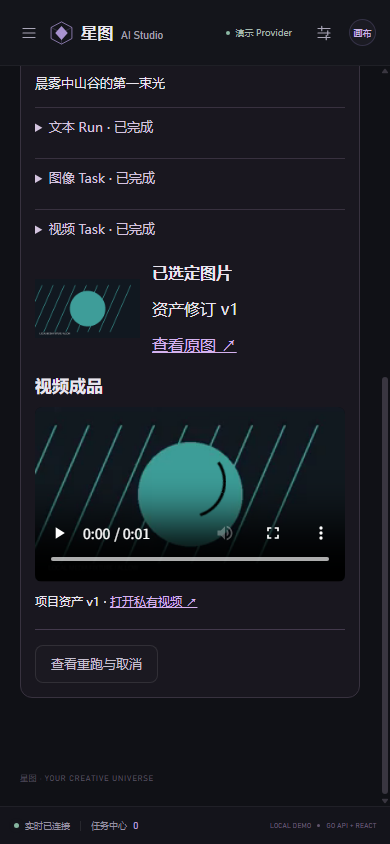
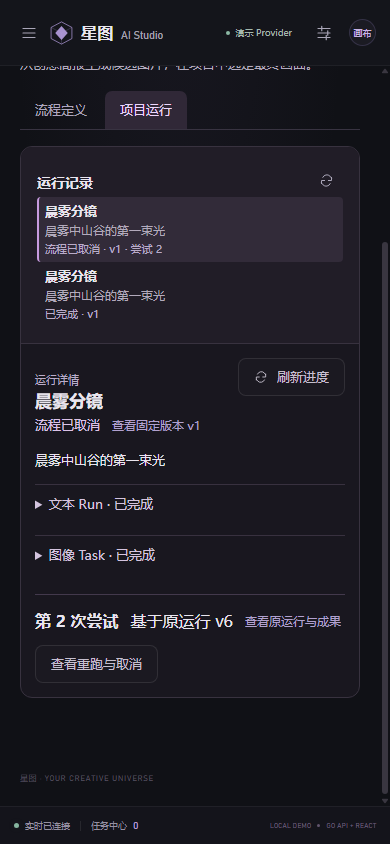

# 0025 · 从指定步骤重跑和停止工作流

## 决策

从原运行选定一个节点，读取会受影响的下游和可沿用的上游。确认后创建新的工作流 ID，登记源 ID、源版本、重跑起点和尝试编号。原运行、原选择、已收费的子资源和操作收据继续可查。新尝试保存自己的指令和输入，生成步骤逐个取得独立报价和授权。上游受理情况仍未知时，先核对原执行，不能从该运行重跑。

## 提交边界

已完成的上游 Run/Task 使用独立继承字段；终态写者只可推进拥有该子执行的原运行。停止父流程与授权检查、原键收据、必要的本地子控制及项目事件同事务。在途媒体已有 handle 时仍按原身份查询，已经执行但交付/费用待核实的资源保留原状态。关闭父流程后用户可以分别查看子任务和账务。

持久项目流中的 `workflow.updated` 仅含流程身份、版本及状态。事件唤起当前项目中的只读补读，接收方保留草稿、未决操作键和有效报价；内容回收或更换后撤去旧私图入口。工作流审计、项目事件水位、流程版本和子资源版本各自独立。

## 取舍及回退

覆盖原图与子资源会丢失已付费执行的证据，同时会让迟到的旧结果污染新尝试。派生独立运行可以允许同一模板重用已批准结果，并重新确认下游成本。每个项目的定义和运行保持现有上限。025 增量不回填视频或新尝试。降级需要恢复完整的升级前数据库与配套私有文件、密钥和对象版本。[025 SQL](../../../db/migrations/025_workflow_attempts.sql) · [集成验收](../../changes/2026-11-21-118-workflow-attempt-integration.md)

## 窄屏实测

左图可在项目里播放已批准的视频，右图可区分原运行及已取消的第 2 次尝试。图中为环回渠道提供的测试素材。

| 私有视频播放 | 原运行与新尝试 |
| --- | --- |
|  |  |
